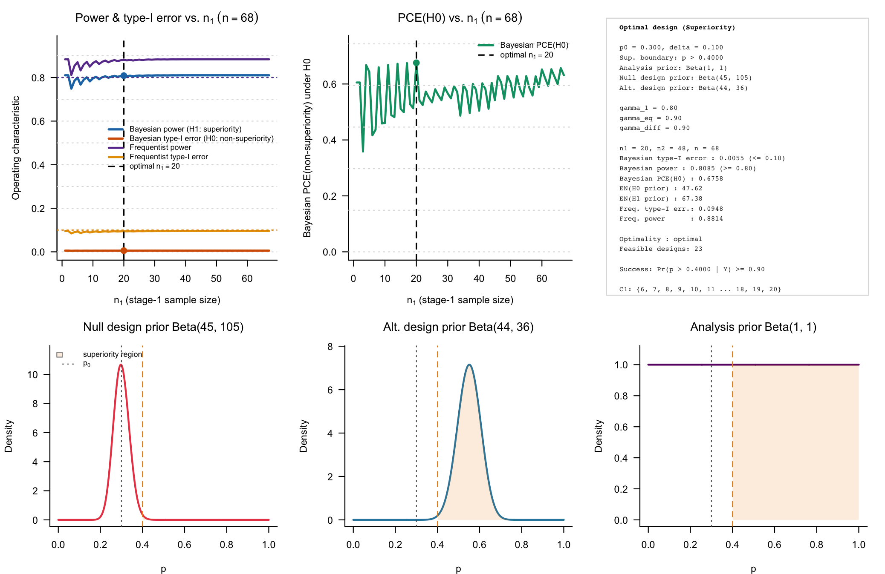
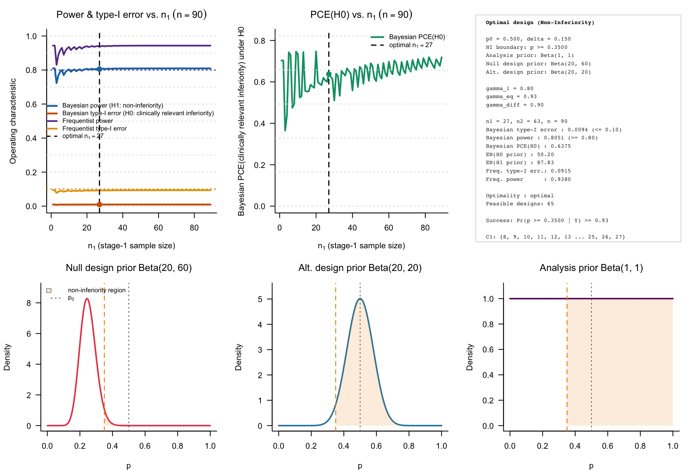

```{r setup, include = FALSE}
knitr::opts_chunk$set(
  collapse = TRUE,
  comment = "#>"
)
```

```{r}
library(bfbin2arm)
```

## Overview

This vignette illustrates deterministic two-stage ROPE-based designs for
single-arm phase II trials with binary endpoints. The functions
`design_singlearm_twostage_rope_ni()` and
`design_singlearm_twostage_rope_sup()` calibrate a design with one interim
analysis and futility-only stopping.

The analysis prior is used to compute posterior ROPE probabilities, whereas
the two design priors describe predictive scenarios under the null hypothesis
$H_0$ and the desired hypothesis $H_1$. For a fixed clinical margin and set of
evidence thresholds, the algorithm first determines the smallest feasible
fixed-sample maximum size $n^*$. It then examines all allocations
$(n_1,n_2)$ with $n_1+n_2=n^*$ and selects the feasible allocation minimizing
the expected sample size under the null design prior, $\mathrm{EN}_0$.

At the interim analysis, continuation requires posterior support for the
desired hypothesis to exceed $1-\gamma_1$. Equivalently, the study stops for
futility when posterior support for the null hypothesis is at least
$\gamma_1$.

## Superiority example: HER2-positive gastric cancer

We first consider a superiority design motivated by a later-line
HER2-positive gastric or gastroesophageal-junction cancer setting. Let the
historical objective-response benchmark be $p_0=0.30$. A response-rate
improvement of at least ten percentage points is considered clinically
meaningful, giving the superiority boundary

\[
  p > p_0 + \delta_{\mathrm{sup}} = 0.30 + 0.10 = 0.40.
\]

The analysis prior is uniform. The null design prior is
$\mathrm{Beta}(45,105)$, centered at 0.30, representing non-superiority
scenarios. The alternative design prior is $\mathrm{Beta}(44,36)$, centered
at 0.55, representing a clearly favorable superiority scenario. We use a
final evidence threshold of 0.90 for superiority and for compelling evidence
for non-superiority. At the interim, the trial stops for futility if posterior
support for non-superiority is at least 0.80.

```{r superiority-design}
sup_2st <- design_singlearm_twostage_rope_sup(
  p0 = 0.30,
  delta = 0.10,
  analysis_prior = c(1, 1),
  design_prior_h0 = c(45, 105),
  design_prior_h1 = c(44, 36),
  gamma_1 = 0.80,
  gamma_eq = 0.90,
  gamma_diff = 0.90,
  alpha = 0.10,
  power = 0.80,
  pce = 0.60,
  alpha_freq = 0.10,
  power_freq = 0.80,
  p_t1e = 0.40,
  p_power = 0.55,
  nmax = 200,
  progress = FALSE
)
```

The `summary` function allows a convenient overview:
```{r}
summary(sup_2st)
```

The selected design reports the maximum sample size $n=n_1+n_2$, the
continuation region at the interim analysis, predictive Bayesian power and
type-I error, the probability of compelling evidence for non-superiority,
and expected sample sizes under the two design priors.

The interim and final decision structures can be inspected graphically.

```{r superiority-plots, fig.width = 10, fig.height = 7, eval = FALSE}
plot(sup_2st, type = "default")
```
```{r echo = FALSE, out.width = "100%", fig.align = "center", fig.cap = "Figure 1: Bayesian calibration of a single-arm two-stage ROPE-based clinical phase II trial with binary endpoints. The test used is a superiority test."}

```

It is also possible to visualize and plot the interim and final continuation regions for the resulting design:
```{r superiority-panels, eval = FALSE}
plot(sup_2st, type = "interim")
plot(sup_2st, type = "final")
```
```{r echo = FALSE, out.width = "45%", fig.align = "center", fig.show='hold', fig.cap = "Figure 2 and 3: Interim continuation and final decision regions for the single-arm two-stage ROPE superiority design."}
knitr::include_graphics(c("figures/singlearm-twostage-rope-ni-sup-fig2.png","figures/singlearm-twostage-rope-ni-sup-fig3.png"))
```

This is helpful for monitoring a two-stage single-arm superiority trial: The first plot on the left shows that between $3$ and $9$ responses, out of $20$, the trial is continued (also compare the upper right panel in Fig. 1). The right plot shows that for the final $n=68$ patients, superiority is declared when at least $33$ responses are observed.

### Single-arm one-stage design for comparison

```{r}
sup_1st <- design_singlearm_onestage_rope(
  p0 = 0.30,
  delta = 0.10,
  direction = "superiority",

  a = 1,
  b = 1,

  da0 = 45,
  db0 = 105,
  da1 = 44,
  db1 = 36,

  gamma_eq = 0.90,
  gamma_diff = 0.90,

  target_power = 0.80,
  target_type1 = 0.10,
  target_pce_h0 = 0.60,

  calibration = "full",

  target_freq_power = 0.80,
  target_freq_type1 = 0.10,

  dp = 0.55,

  n_min = 2,
  n_max = 200
)

sup_1st
```


## Non-inferiority example: chemotherapy de-escalation

We next consider a non-inferiority design motivated by chemotherapy
 de-escalation in HER2-positive early breast cancer. Let the historical
pathological-complete-response benchmark be $p_0=0.50$. A loss of up to 15
percentage points is considered clinically acceptable in exchange for reduced
chemotherapy exposure, giving the non-inferiority boundary

\[
  p \ge p_0-\delta_{\mathrm{NI}}=0.50-0.15=0.35.
\]

We use a uniform analysis prior. The null design prior is
$\mathrm{Beta}(20,60)$, centered at 0.25, and represents clinically relevant
inferiority. The alternative design prior is $\mathrm{Beta}(20,20)$, centered
at 0.50, and represents a plausible non-inferior efficacy scenario. We use
$\gamma_{\mathrm{eq}}=0.925$ to declare non-inferiority,
$\gamma_{\mathrm{diff}}=0.90$ for compelling evidence of inferiority, and
$\gamma_1=0.80$ for interim futility.

```{r noninferiority-design}
ni_2st <- design_singlearm_twostage_rope_ni(
  p0 = 0.50,
  delta = 0.15,
  analysis_prior = c(1, 1),
  design_prior_h0 = c(20, 60),
  design_prior_h1 = c(20, 20),
  gamma_1 = 0.80,
  gamma_eq = 0.925,
  gamma_diff = 0.90,
  alpha = 0.10,
  power = 0.80,
  pce = 0.60,
  alpha_freq = 0.10,
  power_freq = 0.80,
  p_t1e = 0.35,
  p_power = 0.50,
  nmax = 200,
  progress = FALSE
)
```
We summarize the design:
```{r}
summary(ni_2st)
```

Here, interim continuation requires

\[
  \Pr(p\ge 0.35\mid Y_1)>1-\gamma_1=0.20.
\]

Equivalently, the trial stops early for futility if posterior support for
clinically relevant inferiority, $p<0.35$, is at least 0.80. At the final
analysis, non-inferiority is declared when posterior support for
$p\ge0.35$ is at least 0.925.

```{r noninferiority-plots, fig.width = 10, fig.height = 7, eval = FALSE}
plot(ni_2st, type = "default")
```
```{r echo = FALSE, out.width = "100%", fig.align = "center", fig.cap = "Figure 1: Bayesian calibration of a single-arm two-stage ROPE-based clinical phase II trial with binary endpoints. The test used is a non-inferiority test."}

```

```{r non-inferiority-panels, fig.cap = "Interim continuation and final decision regions for the single-arm two-stage ROPE non-inferiority design.", out.width="100%", fig.align="center", eval = FALSE}
plot(ni_2st, type = "interim")
plot(ni_2st, type = "final")
```
```{r echo = FALSE, out.width = "45%", fig.align = "center", fig.show='hold', fig.cap = "Figure 2 and 3: Interim continuation and final decision regions for the single-arm two-stage ROPE non-inferiority design."}
knitr::include_graphics(c("figures/singlearm-twostage-rope-ni-sup-fig5.png","figures/singlearm-twostage-rope-ni-sup-fig6.png"))
```

```{r noninferiority-design-interpretation, results = "asis", echo = FALSE, eval = FALSE}
d <- ni_2st$design
cont <- ni_2st$continuation_region

d$n
d$n1
d$n2
```

For this non-inferiority design, the trial continues after stage 1 when the observed number of responses belongs to $C_1 = \{8,...,19\}$. The maximum sample size is $n=90$, with $n_1=27$ patients enrolled before the interim analysis and $n_2=63$ additional patients enrolled after continuation.

### Single-arm one-stage non-inferiority design for comparison

```{r}
ni_1st <- design_singlearm_onestage_rope(
  p0 = 0.50,
  delta = 0.15,
  direction = "noninferiority",

  a = 1,
  b = 1,

  da0 = 20,
  db0 = 60,
  da1 = 20,
  db1 = 20,

  gamma_eq = 0.925,
  gamma_diff = 0.90,

  target_power = 0.80,
  target_type1 = 0.10,
  target_pce_h0 = 0.60,

  calibration = "full",

  target_freq_power = 0.80,
  target_freq_type1 = 0.10,

  dp = 0.50,

  n_min = 2,
  n_max = 200
)

ni_1st
```

## Interpreting expected sample size

For both examples, the maximum sample size is $n=n_1+n_2$, whereas the
expected sample size under design-prior scenario $j\in\{0,1\}$ is

\[
  \mathrm{EN}_j=n_1+n_2\Pr_{\pi_j^{(d)}}(Y_1\in C_1).
\]

The probability of stopping early for futility under each design scenario can
be recovered from the expected sample size:

```{r early-stop-probabilities}
early_stop_prob <- function(design_object) {
  d <- design_object$design

  c(
    H0 = 1 - (d$EN0 - d$n1) / d$n2,
    H1 = 1 - (d$EN1 - d$n1) / d$n2
  )
}

rbind(
  superiority = early_stop_prob(sup_2st),
  noninferiority = early_stop_prob(ni_2st)
)
```

A large early-stop probability under $H_0$, together with a much smaller
probability under $H_1$, is the intended operating profile of a futility-only
two-stage design: the design conserves patients when the desired clinical
claim is unlikely while preserving adequate predictive power when the desired
hypothesis is plausible.

## Further inspection

The full feasible calibration grid is stored in the `candidates` component
and can be extracted as a data frame.

```{r candidate-grids}
head(as.data.frame(sup_2st))
head(as.data.frame(ni_2st))
```

The generic function is also available when a programmatic workflow benefits
from setting the decision direction explicitly:

```{r generic-interface, eval = FALSE}
design_singlearm_twostage_rope(
  p0 = 0.30,
  delta = 0.10,
  analysis_prior = c(1, 1),
  design_prior_h0 = c(45, 105),
  design_prior_h1 = c(44, 36),
  direction = "superiority"
)
```

## Summary

This vignette illustrated simulation-free two-stage ROPE-based designs for
single-arm phase II trials with binary endpoints in superiority and
non-inferiority settings. Both examples use a single interim analysis with
futility-only stopping and posterior ROPE probabilities as the evidence
measure.

For the superiority illustration, the design evaluates whether the response
probability exceeds the clinically meaningful boundary

\[
  p_0+\delta_{\mathrm{sup}}=0.40.
\]

The trial stops early for futility when posterior support for non-superiority
is at least \(\gamma_1=0.80\), continues otherwise, and declares superiority
at the final analysis when

\[
  \Pr(p>0.40\mid Y)\ge0.90.
\]

For the non-inferiority illustration, the design evaluates whether the
response probability remains above

\[
  p_0-\delta_{\mathrm{NI}}=0.35.
\]

The trial stops early when posterior support for clinically relevant
inferiority is at least \(\gamma_1=0.80\), and declares non-inferiority at
the final analysis when

\[
  \Pr(p\ge0.35\mid Y)\ge0.925.
\]

In both settings, the calibration algorithm first finds the smallest
fixed-sample maximum size \(n^\star\) satisfying the selected operating
characteristic constraints. It then evaluates every allocation
\((n_1,n_2)\) satisfying

\[
  n_1+n_2=n^\star,
\]

and selects the feasible design with the smallest expected sample size under
the null design prior, \(\mathrm{EN}_0\). The resulting design is therefore
optimal conditional on the minimal feasible maximal sample size \(n^\star\).

The main quantities to inspect after calibration are:

- `design$n1`, `design$n2`, and `design$n`: the interim, second-stage, and
  maximum sample sizes.
- `design$type1_2st`: predictive Bayesian type-I error under the null design
  prior.
- `design$power_2st`: predictive Bayesian power under the alternative design
  prior.
- `design$pce_2st`: probability of compelling evidence for the null
  hypothesis, including eligible interim and final evidence paths.
- `design$EN0` and `design$EN1`: expected sample sizes under the null and
  alternative design priors.
- `continuation_region`: stage-1 response counts for which the trial
  continues to stage 2.
- `candidates`: all feasible two-stage allocations considered for the
  fixed maximum sample size.

The generic function
`design_singlearm_twostage_rope()` supports the same workflow through its
`direction` argument. The convenience wrappers
`design_singlearm_twostage_rope_ni()` and
`design_singlearm_twostage_rope_sup()` provide direction-specific interfaces
for non-inferiority and superiority designs, respectively.