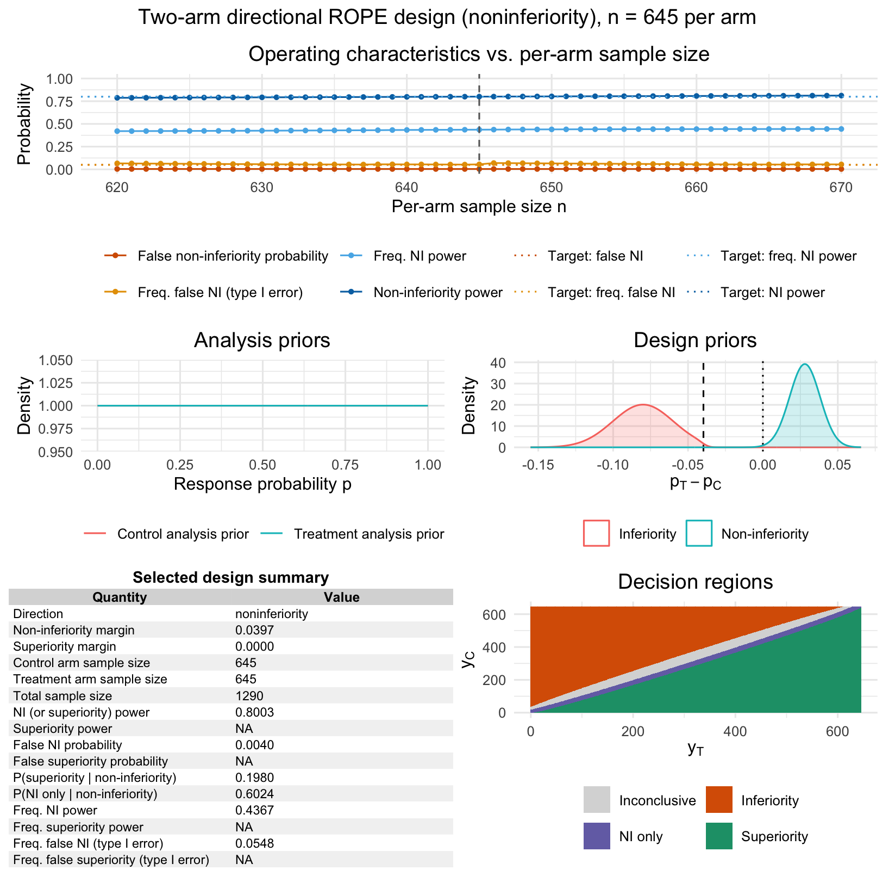
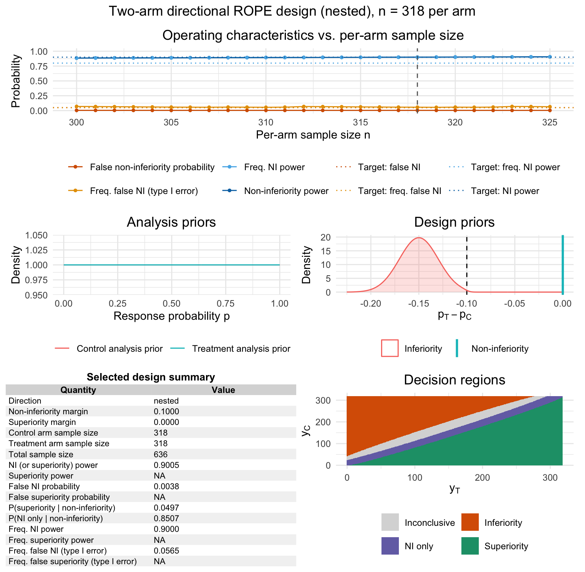

```{r setup, include = FALSE}
knitr::opts_chunk$set(
  collapse = TRUE,
  comment = "#>"
)
```

```{r}
library(bfbin2arm)
```

## Overview

This vignette illustrates the one-stage two-arm directional ROPE design for
binary endpoints using two genuine, published clinical trials. The first
example, ORIGINAL, is a classical non-inferiority trial with a
regulatory-style margin derived from historical placebo-controlled evidence.
The second example, SINGLE, is a nested non-inferiority/superiority trial
that makes the distinction between non-inferiority power and superiority
power explicit: the trial was powered for non-inferiority, and superiority
was assessed only as a secondary, hierarchically nested claim.

Both designs use the risk difference $p_T - p_C$ as the effect measure.
Non-inferiority is declared when the posterior probability of
$p_T - p_C > -\delta_{\mathrm{ni}}$ reaches $\gamma_{\mathrm{ni}}$;
superiority is declared, within the non-inferiority acceptance region, when
the posterior probability of $p_T - p_C > \delta_{\mathrm{sup}}$ reaches
$\gamma_{\mathrm{sup}}$.

## Non-inferiority example: ORIGINAL stroke trial

ORIGINAL compared a modified alteplase regimen against standard alteplase
for acute ischemic stroke, compare @mengTenecteplaseVsAlteplase2024 and @mengTenecteplaseVsAlteplase2024a. The regulatory margin in the published protocol
was specified on the risk-ratio scale, based on prior placebo-controlled
alteplase evidence giving a relative risk of favorable outcome of 1.24
(95% CI 1.14 to 1.36). Preserving 50% of the conservative bound of that
historical effect on the log-relative-risk scale gives the non-inferiority
boundary

\[
\mathrm{RR}_{\mathrm{ni}} = \frac{1}{\sqrt{1.14}} \approx 0.937.
\]

Because this package's two-arm directional engine is parameterized on the
risk-difference scale, we translate this boundary locally at the trial's
planned control response rate $p_C = 0.63$:

\[
\delta_{\mathrm{ni}} = p_C\,(1-\mathrm{RR}_{\mathrm{ni}})
= 0.63 \times (1 - 0.937) \approx 0.0397.
\]

This linearization is only exact at $p_C = 0.63$; it is used here because
the risk-ratio scale is not yet natively supported by the directional
engine (a planned `effect_scale = "risk_ratio"` argument would allow an
exact reproduction). The control-arm response rate itself was elicited from
historical evidence in NOR-TEST and a Chinese alteplase cohort study, giving
the planning value $p_C = 0.63$ used below, compare @mengTenecteplaseVsAlteplase2024.

The design prior under non-inferiority assumes a small true improvement
over the historical control rate, consistent with the trial's planning
assumptions; the design prior under harmful inferiority assumes a
clinically important loss of efficacy at least as large as the margin.

```{r original-design}
design_prior_ni_original <- list(
  type = "baseline_difference",
  baseline = list(mean = 0.63, sd = 0.02, truncation = c(0, 1)),
  difference = list(mean = 0.028, sd = 0.01, truncation = c(-0.0397, 1))
)

design_prior_inf_original <- list(
  type = "baseline_difference",
  baseline = list(mean = 0.63, sd = 0.02, truncation = c(0, 1)),
  difference = list(mean = -0.08, sd = 0.02, truncation = c(-1, -0.0397))
)
```
First, we run a coarse sample size search using `nstep = 25`:
```{r, eval = FALSE}
coarse <- design_twoarm_onestage_rope_ni(
     nmin = 200, nmax = 900, nstep = 25,
     delta_ni = 0.0397, gamma_ni = 0.95, gamma_inf = 0.95,
     analysis_prior_C = c(1, 1), analysis_prior_T = c(1, 1),
     design_prior_ni = design_prior_ni_original,
     design_prior_inf = design_prior_inf_original,
     target_ni_power = 0.80, target_false_ni = 0.05,
     calibration = "Bayesian",
     freq_ni_pC = 0.63,
     freq_ni_delta = 0,              
     target_freq_ni_power = 0.80,
     target_freq_false_ni = 0.05,  
     integration = "quantile",
     quad_nodes = 64L,
     parallel = TRUE, ncores = parallel::detectCores() - 1L,
     parallel_backend = "psock", progress = FALSE
)

coarse
```
```
One-stage two-arm ROPE non-inferiority design 
--------------------------------------------- 

Non-inferiority margin delta_ni: 0.0397 
Superiority margin delta_sup: 0 
Thresholds: gamma_ni = 0.95 , gamma_sup = 0.975 , gamma_inf = 0.95 

Selected design:
  nC = 650 , nT = 650 , N = 1300 

Target non-inferiority (or superiority) power: 0.8000 
Maximum predictive false non-inferiority probability: 0.0500 

Non-inferiority (or superiority) power, P(NI or sup | G_ni): 0.8028 
Superiority power, P(sup | G_sup): NA 
False non-inferiority probability, P(NI or sup | G_inf): 0.0039 
False superiority probability, P(sup | G_not_sup): NA 
```

Then, we refine the search by using `nmin = 620, nmax = 670, nstep = 1`:
```{r, eval = FALSE}
original_ni <- design_twoarm_onestage_rope_ni(
  nmin = 620, nmax = 670, nstep = 1,
  delta_ni = 0.0397,
  gamma_ni = 0.95, gamma_inf = 0.95,
  analysis_prior_C = c(1, 1), analysis_prior_T = c(1, 1),
  design_prior_ni = design_prior_ni_original,
  design_prior_inf = design_prior_inf_original,
  target_ni_power = 0.80, target_false_ni = 0.05,

  calibration = "Bayesian",

  freq_ni_pC = 0.63,
  freq_ni_delta = 0,              
  target_freq_ni_power = 0.80,
  target_freq_false_ni = 0.05,    

  integration = "quantile", quad_nodes = 64L,
  parallel = TRUE, ncores = parallel::detectCores() - 1L,
  parallel_backend = "psock", progress = FALSE
)
```

We inspect the selected design.
```{r, echo = FALSE}
original_ni <- readRDS("cached_original_ni.rds")
```
```{r}
original_ni
```

The selected per-arm sample size, the non-inferiority power under the
non-inferiority design prior, and the false non-inferiority probability
under the harmful design prior can be inspected directly.

```{r}
original_ni$nstar
original_ni$selected_fit$ni_power
original_ni$selected_fit$false_ni
```

Operating characteristics across the searched sample-size range can be
plotted.

```{r original-oc-plot, fig.width = 7, fig.height = 5, eval = FALSE}
plot(original_ni)
```
```{r fig.align = "center", echo = FALSE, out.width = "100%", fig.cap = "Figure 1: Output of the plot function for the non-inferiority single-arm one-stage ROPE design. The top left panel shows Bayesian and frequentist operating characteristics including type-I-error and power for varying sample sizes. The top right panel provides information about the calibrated design found by the calibration algorithm. The lower left and middle panels visualize the analysis and design priors under the inferiority and non-inferiority hypothesis. The bottom right panel displays the decision regions depending on the number of responses in the treatment and control arm."}

```

### Why superiority operating characteristics are not reported here

The summary above reports `NA` for the superiority power and the false
superiority probability. This is expected, not an error, and reflects a
deliberate feature of the directional calibration engine rather than a
missing computation.

`design_twoarm_onestage_rope_ni()` calls the underlying directional engine
with `direction = "noninferiority"`. Under this direction, only two design
priors are required and used: `design_prior_ni`, describing the predictive
scenario under which non-inferiority is expected to hold, and
`design_prior_inf`, describing a clinically important harmful scenario
against which the false non-inferiority probability is evaluated. Neither
`design_prior_sup` nor `design_prior_not_sup` was supplied in the call
above.

The superiority power, $P(\text{superiority}\mid G_{\mathrm{sup}})$,
requires integrating the posterior superiority decision rule against a
design prior $G_{\mathrm{sup}}$ representing a true-superiority scenario.
Because no such design prior was supplied, there is no distribution to
integrate against, and the quantity is correctly reported as `NA` rather
than silently defaulting to zero or some other placeholder value. The false
superiority probability, $P(\text{superiority}\mid G_{\mathrm{not\_sup}})$,
is `NA` for the same reason: it requires `design_prior_not_sup`, which was
also not supplied.

This mirrors how ORIGINAL was actually designed and analyzed: it is a pure
non-inferiority trial with no pre-specified superiority hypothesis, so a
superiority operating characteristic would not be a meaningful quantity to
report for this design. The threshold `gamma_sup = 0.975` still appears in
the printed summary, but only because it is used internally by the
four-way decision matrix to classify each possible outcome $(y_C, y_T)$
into `superiority`, `noninferiority_only`, `inferiority`, or
`inconclusive`. Since no design prior exists over which to average that
classification for the superiority category specifically, the resulting
power quantity has nothing to be averaged against, and remains undefined
for this design.

The nested SINGLE example below in this vignette illustrates the contrasting
case, where a superiority-relevant design prior is available and the
distinction between non-inferiority power and superiority power becomes
directly interpretable.

## Nested non-inferiority/superiority example: SINGLE trial

SINGLE compared dolutegravir/abacavir/lamivudine against a
ritonavir-boosted-atazanavir-based regimen in treatment-naive HIV-1
patients, compare @walmsleyDolutegravirAbacavirLamivudine2013. The trial was designed with 90% power for a non-inferiority
margin of $\delta_{\mathrm{ni}} = 0.10$ on the risk-difference scale, under
the planning assumption of equal 75% response rates at week 48 in both
arms. Because the design prior for non-inferiority assumed no true
difference between arms, the trial's superiority-related operating
characteristic under that same scenario is far lower than its
non-inferiority power: under exact equality, the probability of crossing
the superiority threshold reduces to the nominal one-sided posterior
threshold's complement rather than to anything resembling 90%. The observed
week-48 results, 88% for dolutegravir/abacavir/lamivudine versus 81% for
the comparator, nevertheless crossed both the non-inferiority and
superiority thresholds, which is why the trial was able to report
superiority as a secondary finding.

We reproduce the nested design using the non-inferiority design prior only,
and treat the probability of a superiority conclusion under that same
design prior purely as a derived, secondary quantity. This mirrors how the
trial was actually planned and reported: the primary calibration target is
non-inferiority power, and the chance of a superiority conclusion under the
planning scenario is read off, not separately targeted.

```{r single-design}
design_prior_ni_single <- list(
  type = "baseline_difference",
  baseline = list(mean = 0.75, sd = 0.02, truncation = c(0, 1)),
  difference = list(mean = 0, sd = 1e-6, truncation = c(-0.10, 1))
)

design_prior_inf_single <- list(
  type = "baseline_difference",
  baseline = list(mean = 0.75, sd = 0.02, truncation = c(0, 1)),
  difference = list(mean = -0.15, sd = 0.02, truncation = c(-1, -0.10))
)
```

The trial's own sample-size calculation assumed no true difference between arms as the planning scenario for non-inferiority power — this is a very common convention in non-inferiority trial design, where the "worst realistic case" for powering the NI claim is taken to be exact equality, since that's the scenario under which crossing the NI margin is hardest to guarantee with high probability (there's no true benefit to lean on).

Setting difference `sd = 1e-6` above creates an essentially degenerate point-mass prior at difference `mean = 0`, which is the direct translation of "assume equal response rates" into a design prior. It's not meant to represent genuine uncertainty about the treatment effect — it's meant to pin the calibration exactly at the specific scenario the original trial's own power calculation used, so that the reproduction's `ni_power` target (0.90) can be validated against the real, published sample size.

```{r, eval = FALSE}
single_nested_coarse <- design_twoarm_onestage_rope_nisup(
  nmin = 200,
  nmax = 450,
  nstep = 5,

  delta_ni = 0.10,
  delta_sup = 0,

  gamma_ni = 0.95,
  gamma_sup = 0.95,
  gamma_inf = 0.95,

  analysis_prior_C = c(1, 1),
  analysis_prior_T = c(1, 1),

  design_prior_ni = design_prior_ni_single,
  design_prior_inf = design_prior_inf_single,

  target_ni_power = 0.90,
  target_false_ni = 0.05,

  calibration = "Bayesian",
  
  freq_ni_pC = 0.75,
  freq_ni_delta = 0,              
  target_freq_ni_power = 0.80,
  target_freq_false_ni = 0.05, 
  
  integration = "quantile",
  quad_nodes = 64L,
  parallel = TRUE,
  ncores = parallel::detectCores() - 1L,
  parallel_backend = "psock",

  progress = FALSE
)
```
We inspect the coarse fit:
```{r, echo = FALSE}
single_nested_coarse <- readRDS("cached_single_nested_coarse.rds")
```
```{r}
single_nested_coarse$nstar
```
Thus, at $n=320$ per arm the target constraints were reached. Next, we refine the calibration, by setting `nmin = 300` and `nmax = 325` and `nstep = 1`:
```{r, eval = FALSE}
single_nested <- design_twoarm_onestage_rope_nisup(
  nmin = 300,
  nmax = 325,
  nstep = 1,

  delta_ni = 0.10,
  delta_sup = 0,

  gamma_ni = 0.95,
  gamma_sup = 0.95,
  gamma_inf = 0.95,

  analysis_prior_C = c(1, 1),
  analysis_prior_T = c(1, 1),

  design_prior_ni = design_prior_ni_single,
  design_prior_inf = design_prior_inf_single,

  target_ni_power = 0.90,
  target_false_ni = 0.05,

  calibration = "Bayesian",
  
  freq_ni_pC = 0.75,
  freq_ni_delta = 0,              
  target_freq_ni_power = 0.80,
  target_freq_false_ni = 0.05, 
  
  integration = "quantile",
  quad_nodes = 64L,
  parallel = TRUE,
  ncores = parallel::detectCores() - 1L,
  parallel_backend = "psock",

  progress = FALSE
)
```
We inspect the fit:
```{r, echo = FALSE}
single_nested <- readRDS("cached_single_nested.rds")
```
```{r}
single_nested
```
Now, given the finer calibration search, $n=318$ patients is the first sample size at which the target constraints are met.

As with the ORIGINAL example above, `sup_power` and `false_sup` are
reported as `NA` here. This design was calibrated with `design_prior_sup`
and `design_prior_not_sup` left unspecified, since only a true-superiority
scenario and a true-non-superiority scenario would allow those two
quantities to be computed, and neither is part of how SINGLE was actually
planned. The quantity of interest for demonstrating the non-inferiority
power versus superiority power distinction is instead the probability of a
*superiority conclusion* evaluated under the non-inferiority design prior,
$P(\text{superiority}\mid G_{\mathrm{ni}})$, which is available directly
from the nested decision breakdown below.

```{r}
single_nested$nstar
single_nested$selected_fit$ni_power
single_nested$selected_fit$p_sup_g_ni
```

The non-inferiority power at the selected sample size matches the trial's
planning target closely, while the probability of concluding superiority
under that same, null design prior is far smaller, just 5%. This numerically
demonstrates the distinction between non-inferiority power and superiority
power: a design can be highly powered to conclude non-inferiority (90%) while
having very little chance of concluding superiority (5%), if the design prior
places its mass at or near equality.

The full four-way decision breakdown under the non-inferiority design
prior shows how often each of the four possible conclusions (superiority,
non-inferiority-only, inferiority, inconclusive) occurs under the trial's
own planning assumption.

```{r}
c(
  superiority          = single_nested$selected_fit$p_sup_g_ni,
  noninferiority_only  = single_nested$selected_fit$p_ni_only_g_ni,
  inferiority           = single_nested$selected_fit$p_inf_g_ni,
  inconclusive          = single_nested$selected_fit$p_inc_g_ni
)
```
```{r, eval = FALSE}
plot(single_nested)
```
```{r fig.align = "center", echo = FALSE, out.width = "100%", fig.cap = "Figure 2: Output of the plot function for the nested non-inferiority-superiority single-arm one-stage ROPE design in the setting of the SINGLE trial. The top left panel shows Bayesian and frequentist operating characteristics including type-I-error and power for varying sample sizes. The top right panel provides information about the calibrated design found by the calibration algorithm. The lower left and middle panels visualize the analysis and design priors under the inferiority and non-inferiority hypothesis. The bottom right panel displays the decision regions depending on the number of responses in the treatment and control arm."}

```

### Checking the observed trial result against the calibrated design

The trial's actual week-48 results can be evaluated directly against the
calibrated design's decision rule, using the observed responder counts at
the trial's actual per-arm sample sizes (419 on the comparator arm and 414
on the study arm).

```{r single-observed}
nC_obs <- 419
nT_obs <- 414

yC_obs <- round(0.81 * nC_obs)
yT_obs <- round(0.88 * nT_obs)

decision_obs <- bfbin2arm:::.directional_decision_matrix_twoarm(
  nC_obs, nT_obs,
  delta_ni = 0.10, delta_sup = 0,
  gamma_ni = 0.975, gamma_sup = 0.975, gamma_inf = 0.975,
  analysis_prior_C = c(1, 1), analysis_prior_T = c(1, 1),
  integration = "quantile", quad_nodes = 64L
)

decision_obs$superiority[yC_obs + 1L, yT_obs + 1L]
decision_obs$noninferiority_only[yC_obs + 1L, yT_obs + 1L]
```

The observed data cross the superiority threshold, consistent with the
trial's own reported secondary superiority finding, even though the design
was calibrated purely on non-inferiority power.

## Comparing the two examples

```{r comparison-table, echo = FALSE}
comparison <- data.frame(
  Trial = c("ORIGINAL (stroke)", "SINGLE (HIV)"),
  Margin_scale = c("Risk ratio, locally converted to RD", "Risk difference"),
  delta_ni = c(0.0397, 0.10),
  Control_rate_pC = c(0.63, 0.75),
  n_per_arm_selected = c(original_ni$nstar, single_nested$nstar),
  ni_power = round(
    c(original_ni$selected_fit$ni_power, single_nested$selected_fit$ni_power), 3
  ),
  p_superiority_under_ni_prior = round(
    c(NA, single_nested$selected_fit$p_sup_g_ni), 3
  )
)

knitr::kable(comparison)
```

The table quantifies the central methodological point of this vignette.
ORIGINAL is a pure non-inferiority design with no superiority-relevant
design prior at all, so no probability of a superiority conclusion is
reported. SINGLE, by contrast, is a nested design calibrated to reach 90%
non-inferiority power, yet under the very same design
prior used for that calibration, the probability of additionally
concluding superiority is only 0.05. This large gap between a
non-inferiority power of 0.900 and a superiority-conclusion probability of
0.05, evaluated under the identical design prior, is the numerical
demonstration of why non-inferiority power and superiority power are
distinct operating characteristics: a trial can be highly powered to
establish non-inferiority while having very little chance of additionally
establishing superiority, whenever the design prior places its mass at or
near equality between arms. Consistent with this, the trial's own week-48
results crossed the superiority threshold only because the observed
treatment effect happened to fall well outside the design prior's
equality-centered scenario, not because the design was powered to detect
it.

The table highlights the central methodological point of this vignette:
ORIGINAL is a pure non-inferiority design with no superiority-relevant
design prior at all, whereas SINGLE is a nested design in which the
probability of a superiority conclusion is not separately targeted but
instead follows, as a much smaller derived quantity, from the same design
prior used to calibrate non-inferiority power. Even though the eventual decision in the SINGLE trial can additionally state superiority (next to the non-inferiority claim), the trial was originally *not* powered to detect superiority. If the goal would have been to detect superiority, a design calibration with a superiority and non-superiority design prior would have been appropriate instead.

## References