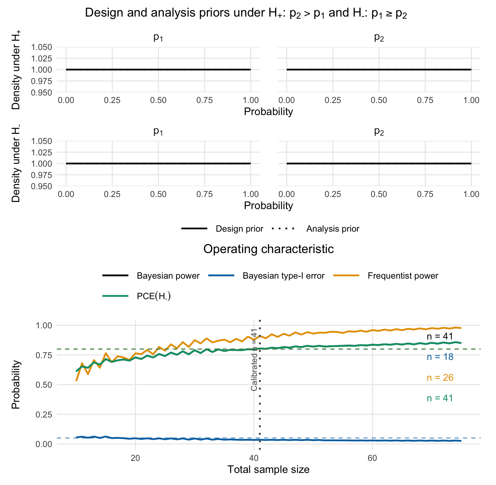
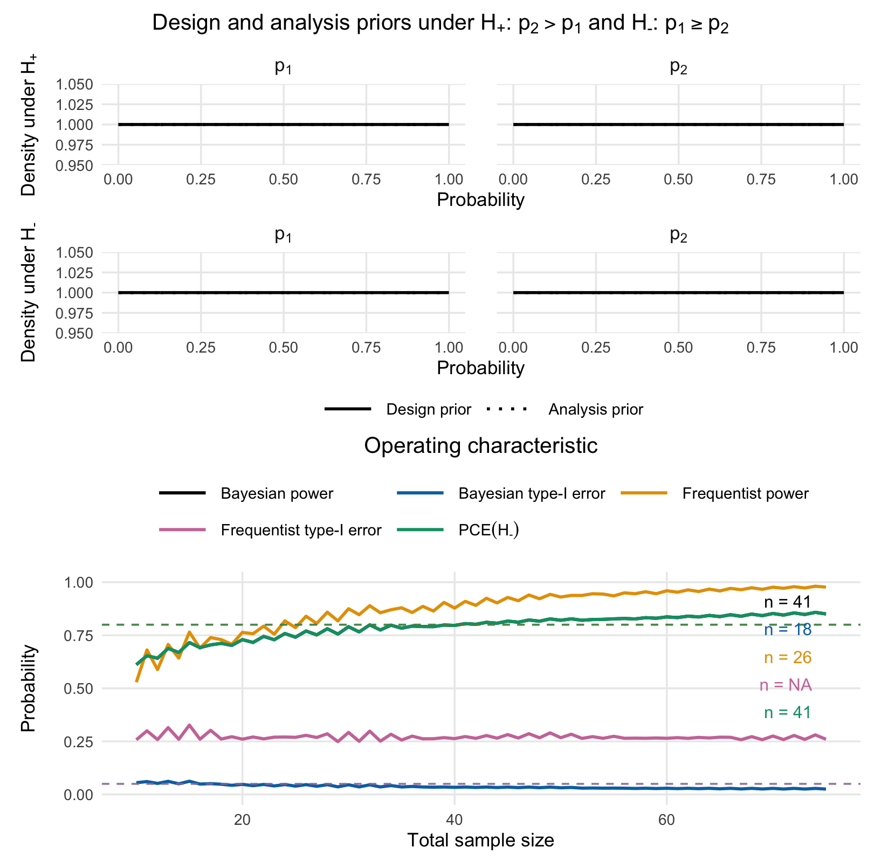
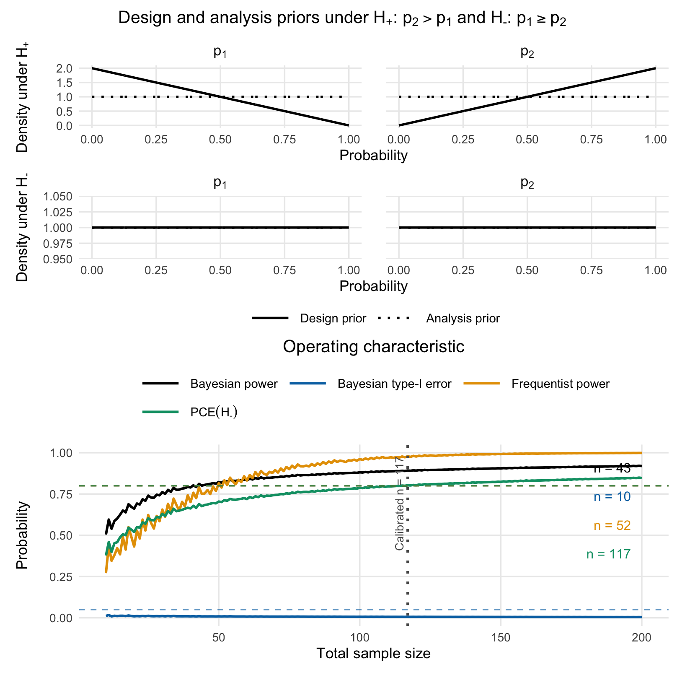
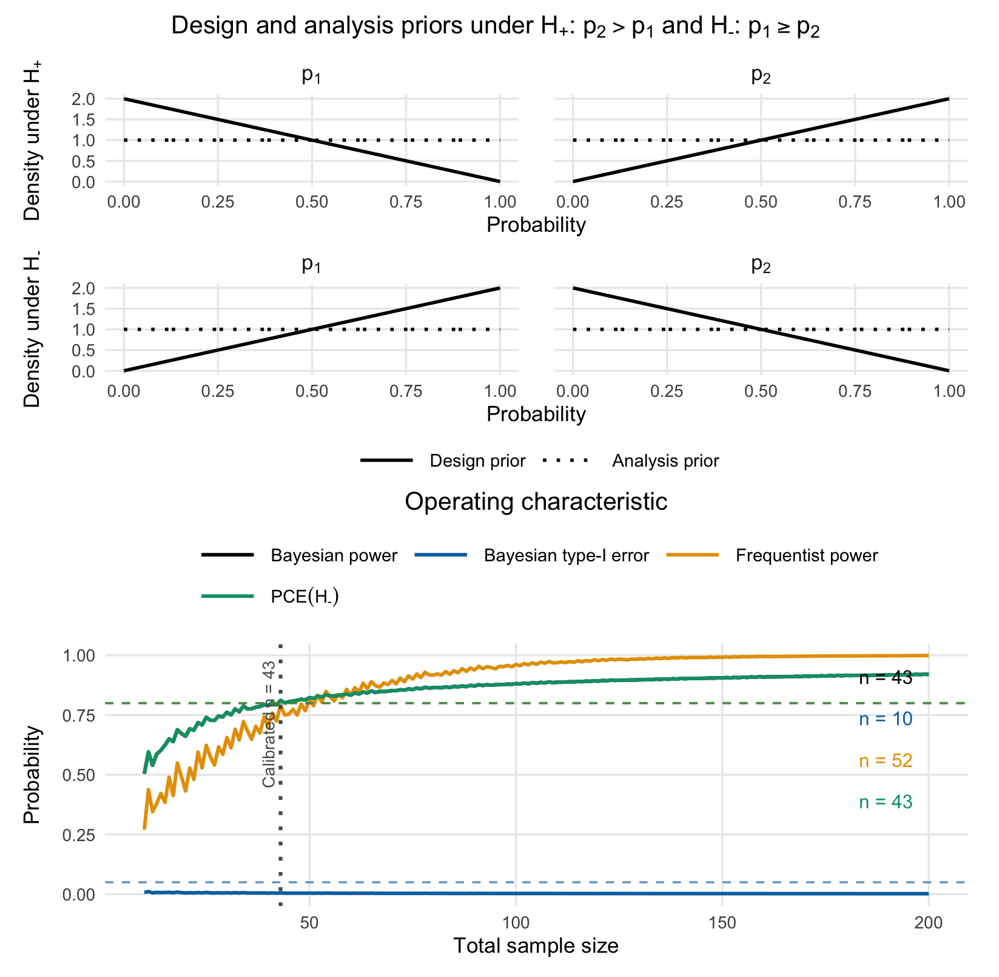
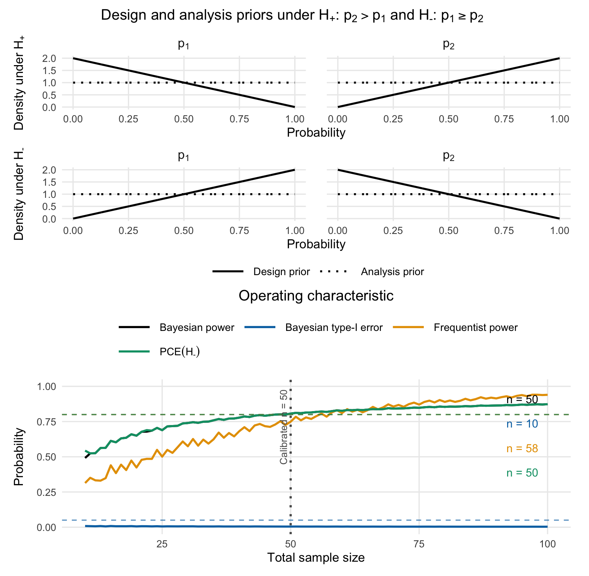
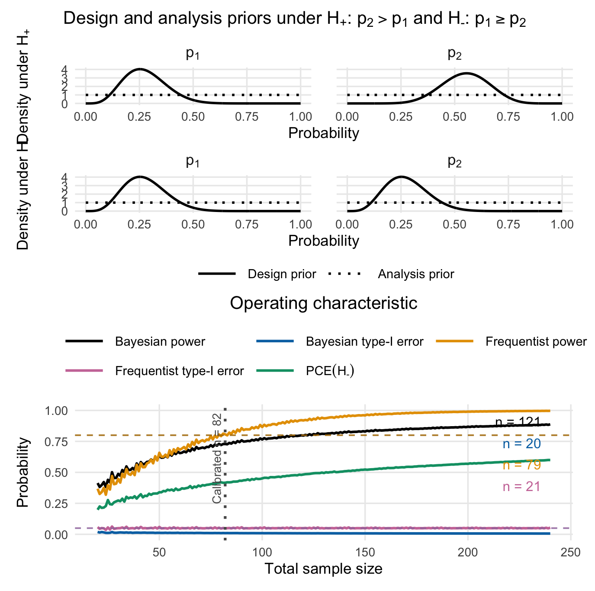

```{r setup, include = FALSE}
knitr::opts_chunk$set(
  collapse = TRUE,
  comment = "#>",
  fig.width  = 7,
  fig.height = 5,
  dpi        = 100,
  fig.retina = 1,
  dev        = "png",
  dev.args   = list(type = "cairo-png")
)
options(bfbin2arm.ncores = 1L)
library(bfbin2arm)
```

# Introduction and Overview
In this vignette, we illustrate how to calibrate a two-arm one stage phase II design with binary endpoints from a Bayesian perspective. Details on the methodology can be found in [@kelterTwoArmSingleStage2026]. Our main assumption here is that the observed data in both groups are from two random variables $Y_1,Y_2$ which both follow a binomial distribution with parameters $n_1$ and $n_2$ and $p_1$ respectively $p_2$,
$$Y_1\sim \mathrm{Bin}(n_1,p_1), \hspace{1cm} Y_2\sim \mathrm{Bin}(n_2,p_2)$$

## Hypothesis tests

In its current form, the package implements four different hypothesis tests for such trials:

$$H_0:p_1=p_2 \hspace{1cm} \text{ versus } \hspace{1cm} H_1:p_1\neq p_2$$

Alternatively, a well-known parameterization of this test introduces a difference parameter $\eta=p_2-p_1$ and the grand mean $\zeta=\frac{1}{2}(p_1+p_2)$. Using this parameterization, we have

$$p_1=\zeta-\frac{\eta}{2}, \hspace{1cm} p_2=\zeta+\frac{\eta}{2}$$

and the hypotheses can be rewritten as:

$$H_0:\eta = 0 \hspace{1cm} \text{ versus } \hspace{1cm} H_1:\eta \neq 0$$

Next to this two-sided test, three directional tests are available in the package:

- $$H_0:\eta \leq 0 \hspace{1cm} \text{ versus } \hspace{1cm} H_1:\eta > 0$$
- $$H_0:\eta = 0 \hspace{1cm} \text{ versus } \hspace{1cm} H_1:\eta > 0$$
- $$H_0:\eta = 0 \hspace{1cm} \text{ versus } \hspace{1cm} H_1:\eta < 0$$

For each of the four tests, a separate Bayes factor exists and can be used. For the two-sided test, we denote the Bayes factor as $BF_{01}$, and for the three directional tests above we denote the Bayes factors as $BF_{+-}$, $BF_{+0}$ and $BF_{-0}$. Thus, the test of $H_0:\eta \leq 0$ versus $H_1:\eta >0$ can also be written as $H_-:p_2 \leq p_1$ versus $H_+:p_2 > p_1$.

## Design and analysis priors
The $\mathrm{Beta}(a_0,b_0)$ distribution is a conjugate prior for the binomial likelihood, and when chosen as the prior, the posterior $P_{p \mid Y}$ is also Beta-distributed. A natural choice for the priors is the beta distribution. We assume independent Beta design priors $H_0$ as follows:

$$p_1 =p_2 = p\mid H_0 \sim \mathrm{Beta}(a_0^d,b_0^d)$$

Thus, under $H_0:\eta = 0$, both probabilities are identical, $p_1=p_2$, and take some value $p\in [0,1]$, which has a beta design prior. Likewise, we pick independent Beta design priors under $H_1:\eta \neq 0$:

$$p_1 \mid H_1 \sim \mathrm{Beta}(a_1^d,b_1^d), \hspace{1cm} p_2 \mid H_1 \sim \mathrm{Beta}(a_2^d,b_2^d)$$

For the analysis priors $P_{p_1}^a$, $P_{p_2}^a$ under $H_1$, we also choose independent Beta priors, with possibly different values $a_i^a$ and $b_i^a$ for $i=1,2$, where the superscript signals that the hyperparameters belong to our analysis instead of design prior:

$$p_1 \mid H_1 \sim \mathrm{Beta}(a_1^a,b_1^a), \hspace{1cm} p_2 \mid H_1 \sim \mathrm{Beta}(a_1^a,b_1^a)$$

Lastly, for the analysis prior $P_{p}^a$ under $H_0:\eta=0$, we choose a Dirac prior with all probability on $\eta=p_2-p_1=0$ conditionally on a uniform prior on $\zeta$, that is

$$p_1=p_2=p|H_0 \sim 1_{\{\eta=0\}}| \zeta \sim U(0,1)$$

for the analysis with the Bayes factor.

# Using the package

First, we load the package after installation:
```{r}
library(bfbin2arm)
```

Next, we illustrate the main calibration function for a two-arm one-stage trial by re-analyzing a phase II trial in the context of oncology. While no Bayesian approach was used in the original statistical analysis of the trial, the step-by-step walktrough below showcases how a structured approach to designing and calibrating a Bayesian two-arm one-stage phase II trial with the `bfbin2arm` package looks like. Importantly, the trial must have two trial arms (treatment and control) and binary endpoints. We assume further that one of the four tests detailed above is carried out using Bayes factors as the test criterion. 

# Clinical Example 1: The ICT-107 glioblastoma phase II Trial

The ICT-107 trial [@wenRandomizedDoubleBlindPlaceboControlled2019] was a randomized phase II study in newly diagnosed glioblastoma patients (n=124, 2:1 randomization). The primary binary endpoint is progression status at 6 months (PFS6), and the secondary binary endpoint immunologic status. Here, we focus on the secondary endpoint for illustration purposes. 

**Reported results** (ITT population):

- ICT-107 (n=82): 49/82 responders= **59.7% response rate**
- Control (n=42): 12/42 responders = **35.7% response rate**

## 1. Bayes Factor Analysis

We start by calculating the Bayes factor(s) for the ICT-107 trial data:
```{r}
## -------------------------------------------------------------
## 2. ICT-107 trial (immunologic response)
##    Placebo (control): 12 responders, 31 non-responders
##    ICT-107 (treatment): 49 responders, 32 non-responders  
## -------------------------------------------------------------

y1_ict <- 12      # control successes
n1_ict <- 12 + 31
y2_ict <- 49      # treatment successes
n2_ict <- 49 + 32

cat("\n=== ICT-107 Trial (n1 =", n1_ict, ", n2 =", n2_ict, ") ===\n")

# BF01
BF01_ict = twoarmbinbf01(y1_ict, y2_ict, n1_ict, n2_ict, 
                         a_0_a = 1, b_0_a = 1, 
                         a_1_a = 1, b_1_a = 1, 
                         a_2_a = 1, b_2_a = 1)

# BF+1
BFp1_ict = BFplus1(y1_ict, y2_ict, n1_ict, n2_ict, 
                   a_1_a = 1, b_1_a = 1, 
                   a_2_a = 1, b_2_a = 1)

# BF-1
BFm1_ict = BFminus1(y1_ict, y2_ict, n1_ict, n2_ict, 
                    a_1_a = 1, b_1_a = 1, 
                    a_2_a = 1, b_2_a = 1)

# BF+0
cat("=== ICT-107 Trial === Bayes factor BF+0 results in ", BFplus0(BFp1_ict, BF01_ict))

# BF+-
cat("=== ICT-107 Trial === Bayes factor BF+- results in ", BFplusMinus(BFp1_ict, BFm1_ict))
```
The most relevant Bayes factor here is $BF_{+-}$, because it is directional and leaves open the possibility of the placebo group having a larger response rate than the treatment group. Note that the hyperparameters of the beta analysis priors are specified in `twoarmbinbf01` via `a_0_a = 1, b_0_a = 1` et cetera.

## 2. Operating characteristics for actual sample sizes
Now, a key question is which operating characteristics can be expected based on the actual sample sizes used in the trial. The `powertwoarmbinbf01` function can provide the answer:
```{r, eval = FALSE}
ict_results <- powertwoarmbinbf01(
  n1 = n1_ict, n2 = n2_ict,
  k = 1/3, k_f = 3,
  test = "BF+-",  # H+: p2 > p1 vs H-: p2 <= p1
  a_0_d = 1, b_0_d = 1, a_0_a = 1, b_0_a = 1,
  a_1_d = 1, b_1_d = 1, a_2_d = 1, b_2_d = 1,
  a_1_a = 1, b_1_a = 1, a_2_a = 1, b_2_a = 1,
  output = "numeric",
  compute_freq_t1e = TRUE,
)
print(ict_results)
```
```
Power             Type1_Error 
              0.8788106               0.0214111 
                  CE_H0 Frequentist_Type1_Error 
              0.8788106               0.2871811 
attr(,"hypothesis")
[1] "H[+]:~p[2] > p[1] ~~ vs ~~ H[-]:~p[2] <= p[1]"
attr(,"compute_freq_t1e")
[1] TRUE
```
We see that based on the actual sample sizes and a moderate evidence threshold $k=1/3$, the Bayesian power is sufficiently large with $87.8\%$. Still, the frequentist type-I-error rate is way too high with $28.7\%$, so we increase the evidence threshold to $k=1/10$ (strong evidence) and use the `ntwoarmbinbf01` function to calibrate the design based on our requirements next.

## 3. Power and sample size planning

The core working function to design a Bayesian two-arm one-stage trial with the package is the `design_twoarm_onestage_bf()` function. It searches over a grid of total sample sizes and returns a **design object** that contains

- the selected sample sizes in each arm (`n1`, `n2`) and their sum (`n_total`)
- Bayesian and frequentist operating characteristics at the chosen design
- the full search grid with pointwise and sustained feasibility indicators
- the calibration targets and input priors used in the search.

Internally, the function uses the same numerical engine as the legacy `ntwoarmbinbf01()` function, but exposes a richer, object-based interface and S3 methods for printing, summarizing, and plotting. The old function `ntwoarmbinbf01()` remains available as a compatibility wrapper that now returns the same design object.

First, we perform a sample size search for an ICT-107-type trial (balanced arms) under flat design priors and substantial evidence thresholds, using the directional Bayes factor \(BF_{+-}\). Note that evidence in favour of $H_-$ happens when $BF_{+-}<k$ for $k<1$. Internally, the function therefore uses the Bayes factor $BF_{-+}$ when calibrating the design, but for our purposes this does not matter. Selecting $BF_{+-}$ will use the directional test we intend to use when calibrating our design:

```{r, out.width = "80%", out.height="500px", eval = FALSE, cache = TRUE}
des <- design_twoarm_onestage_bf(
  n_min = 10,
  n_max = 75,
  k = 1/3,
  k_f = 3,
  test = "BF+-",
  calibration = "Bayesian",
  target_power = 0.80,
  target_type1 = 0.05,
  target_ce_h0 = 0.80,
  # design and analysis priors: flat Beta(1,1) everywhere
  a_0_d = 1, b_0_d = 1,
  a_0_a = 1, b_0_a = 1,
  a_1_d = 1, b_1_d = 1,
  a_2_d = 1, b_2_d = 1,
  a_1_a = 1, b_1_a = 1,
  a_2_a = 1, b_2_a = 1,
  # assumed true proportions for frequentist power (optional here)
  p1_power = 0.3, p2_power = 0.6,
  report_freq_type1 = TRUE,
  # equal randomisation
  alloc1 = 0.5,
  alloc2 = 0.5,
  # require sustained feasibility over the next 10 larger n
  sustain_n = 10L,
  progress = FALSE
)
```
We can summarize or print the results with the `print()` and `summary()` methods:
```{r, eval = FALSE}
summary(des)
```
```
Summary: One-stage two-arm Bayes factor design
---------------------------------------------
Mode:        optimal
Status:      Smallest feasible one-stage two-arm design found.
Calibration: Bayesian
Feasible:    yes

Search overview
  n evaluated          = 66
  pointwise feasible   = 35
  sustained feasible   = 35
  first pointwise n    = 41
  first sustained n    = 41

Selected design
  n_total = 41, n1 = 20, n2 = 21
```

Also, we can plot the results:
```{r, out.width="80%", out.height="600px", eval = FALSE}
plot(des)
```
```{r echo = FALSE, out.width = "80%", fig.align = "center", fig.cap = "Figure 1: Visualization of the calibrated Bayesian two-arm one-stage phase II design with a binary endpoint"}

```
The summary and plot show that for the range of sample sizes provided to the function, under flat design priors, recruiting $41$ patients in total satisfies the requirement of Bayesian power $\geq 0.80$. In general, if we want to obtain a calibrated design we can either increase `n_max` if no calibrated design is found in a search range, or choose more informative design priors. Alternatively, we could shift to a less stringent threshold for evidence $k$, e.g. $k=1/3$ instead of $k=1/10$, so it becomes easier for the Bayes factor to accumulate evidence in favour of $H_+$. 

The arguments correspond closely to the conceptual requirements:

- `k` is the evidence threshold for rejecting the null (inverted Bayes factor). Here, `k = 1/10` corresponds to moderately strong evidence against the null.
- `k_f` is the threshold for compelling evidence in favour of the null (here, \(k_f = 10\) in favour of \(H_-\)).
- `calibration` selects which constraints to enforce: `"Bayesian"` uses Bayesian power, type-I error, and CE(H0); `"frequentist"`, `"hybrid"`, and `"full"` add frequentist constraints. Frequentist calibration implies that frequentist power and type-I-error rare calibrated, hybrid calibration implies that Bayesian power and frequentist type-I-error are calibrated, and full calibration implies that both frequentist and Bayesian power and type-I-error are calibrated.
- `target_power`, `target_type1`, and `target_ce_h0` are the Bayesian calibration targets.
- `p1_power` and `p2_power` specify the assumed proportions for frequentist power (when used), here \(p_1 = 0.3\) and \(p_2 = 0.6\).
- `alloc1` and `alloc2` specify randomisation probabilities for control and treatment; here we use equal allocation.

The resulting object `des` shows in its print and summary output whether a feasible design was found and, if so, which sample sizes and operating characteristics are selected. The old three-panel plot is now available via

```r
plot(des, type = "old")
```

which reproduces the original `ntwoarmbinbf01(output = "plot")` visualisation. For this default plot, it is also possible to just call
```r
plot(des)
```
In addition, two more compact plot types are provided:

```r
plot(des, type = "oc")          # operating characteristics across n_total
plot(des, type = "feasibility") # pointwise vs sustained feasibility across n_total
```

The old function `ntwoarmbinbf01()` is still available for backward compatibility. It now returns the same design object as `design_twoarm_onestage_bf()` and internally calls that function. A simple compatibility call is:

```{r, eval = FALSE, out.width="80%", cache = TRUE}
des_legacy <- ntwoarmbinbf01(
  k = 1/3, k_f = 3,
  power = 0.8, alpha = 0.05, pce_H0 = 0.8,
  test = "BF+-",
  nrange = c(10, 75), n_step = 1,
  progress = FALSE,
  compute_freq_t1e = TRUE,
  p1_power = 0.3, p2_power = 0.6,
  alloc1 = 0.5, alloc2 = 0.5,
  output = "numeric"
)
```
We plot the results:
```{r, eval = FALSE}
plot(des_legacy, type = "old")
```
```{r echo = FALSE, out.width = "80%", fig.align = "center", fig.cap = "Figure 2: Visualization of the calibrated Bayesian two-arm one-stage phase II design with a binary endpoint"}

```

This code path is mainly intended for users with existing scripts; new analyses should use `design_twoarm_onestage_bf()` directly.

## 4. Informative design priors

The example above used flat design priors, which might be unrealistic in a variety of settings. While it would be possible to increase the maximum sample size `n_max` in the search range to eventually find a calibrated trial design, a more helpful approach is to use informative design priors. Such design priors should reflect the expectations investigators have about the effect of a novel drug or treatment. In particular, it is strongly recommended to use at least slightly informative design priors, because if no expectation about the effect of the drug or treatment (e.g. due to prior phase I trials) is made, this might be unrealistic from a practical point of view. Not only is the question why and whether a phase II trial should be conducted in such a case. Using flat design priors is highly unrealistic in several aspects:

- Suppose flat design priors are assumed under $H_1$ for the treatment and the control group. We focus on the treatment group just for a moment. All parameter values inside the unit interval $[0,1]$ are being assigned the same prior probability density value. As a consequence, all parameter values (or small regions around them, as from a measure theoretic-point of view single parameter values have prior probability of exactly zero) are equally likely a priori before any data are observed. This implies, that e.g. success probabilities like $p_2=0.99$ are equally likely a priori as $p_2=0.4$, which in almost all phase II trials would be a very questionable assumption for the treatment group in the two-arm setting.
- Using flat design priors under both $H_0$ and $H_1$ implies that when the null hypothesis is true and $p_1\leq p_2$ holds, all parameter values $p_1$ (the success probability in the control group) less than or equal to $p_2$ are equally likely a priori. However, in most phase II trials investigators would argue that extremely large differences $p_1 \leq p_2 \Leftrightarrow p_2-p_1 \geq 0$ in the success probabilities between both trial arms are less likely a priori than smaller ones. As a consequence, a more informative design prior under $H_0$ which places more mass at the boundary region $p_1=p_2$ could be more realistic.

Next, we therefore perform a sample size search for the ICT-107-type trial (balanced arms) under informative design priors with very strong evidence thresholds `k = 1/30` and `k_f = 30`. Notice the additionally specified parameters `a_1_d = 1, b_1_d = 2` and `a_2_d = 2, b_2_d = 1` which are the design prior hyperparameters of the Beta design priors for $p_1$ and $p_2$ under $H_+$. These express slight optimism about the treatment effect in the sense that they can be thought of as having already observed 1 success and 2 failures in the control group and 2 successes and 1 failure in the treatment group. Also, we lower our requirements for the probability of compelling evidence in favour of $H_0$ to, say, $60%$. We additionally require the reporting of the frequentist type-I-error for the calibrated design by specifying `report_freq_type1 = TRUE` in the function call:
```{r, out.width='80%', cache = TRUE, eval = FALSE}
des_informative <- design_twoarm_onestage_bf(
  n_min = 10,
  n_max = 200,
  k = 1/10,
  k_f = 10,
  test = "BF+-",
  calibration = "Bayesian",
  target_power = 0.80,
  target_type1 = 0.05,
  target_ce_h0 = 0.80,
  # design and analysis priors: flat Beta(1,1) everywhere
  a_0_d = 1, b_0_d = 1,
  a_0_a = 1, b_0_a = 1,
  a_1_d = 1, b_1_d = 2,
  a_2_d = 2, b_2_d = 1,
  a_1_a = 1, b_1_a = 1,
  a_2_a = 1, b_2_a = 1,
  # assumed true proportions for frequentist power (optional here)
  p1_power = 0.3, p2_power = 0.6,
  # report frequentist type-I-error? (optional here)
  report_freq_type1 = TRUE,
  # equal randomisation
  alloc1 = 0.5,
  alloc2 = 0.5,
  # require sustained feasibility over the next 10 larger n
  sustain_n = 10L,
  progress = FALSE
)
```
We summarize the results:
```{r, eval = FALSE}
summary(des_informative)
```
```
Summary: One-stage two-arm Bayes factor design
---------------------------------------------
Mode:        optimal
Status:      Smallest feasible one-stage two-arm design found.
Calibration: Bayesian
Feasible:    yes

Search overview
  n evaluated          = 191
  pointwise feasible   = 85
  sustained feasible   = 84
  first pointwise n    = 115
  first sustained n    = 117

Selected design
  n_total = 117, n1 = 58, n2 = 59
```
The output shows that the first feasible sample size for which the target constraints hold was $n=115$. However, as we require the next ten sample sizes for the operating characteristics not to violate their respective constraint (that is, power should not decrease below its specified target threshold, type-I-error not increase above its specified target threshold and probability of compelling evidence not drop below its specified target threshold for the next ten observations), the first sample size for which this holds is $n=117$. This leads to the selected design with $n_1=58$ and $n_2=59$ patients in the control and treatment group.

**Details on the implementation:** For each operating characteristic we also compute a metric‑specific sustained attainment sample size that respects the user‑supplied sustain_n constraint. Concretely, we form separate logical indicators over the search grid for Bayesian power (≥ target_power), Bayesian type‑I error (≤target_type1), CE(H0) (≥target_ce_h0), and frequentist power (≥target_freq_power). Given such an indicator vector for a particular metric, we then search for the first total sample size $n$ such that the metric’s target is satisfied not only at $n$, but also for all subsequent total sample sizes in the forward window of length 
`sustain_n + 1`, truncated at the upper end of the search range. The vertical reference lines in the diagnostic plots are drawn at these metric‑specific sustained crossing points. This ensures that the plotted “required” sample sizes reflect the same sustained feasibility logic as the calibration itself, so that, for example, Bayesian power may first reach its nominal threshold at $n=115$, but the corresponding vertical line will only be shown at $n=117$ if the power constraint fails to remain satisfied over the next 
`sustain_n` total sample sizes.

```{r sustain-logic-schematic, out.width = "80%", echo = FALSE, fig.align = "center"}
library(ggplot2)

# Illustrative total sample sizes
ns <- 68:86

# Hand-crafted operating characteristic:
# first crosses the target, then drops below, then rises and stays above
oc_vals <- c(
  0.72, 0.75, 0.78, 0.81, 0.79, 0.77, 0.78, 0.79, 0.80,
  0.82, 0.84, 0.85, 0.86, 0.87, 0.87, 0.88, 0.88, 0.89, 0.89
)

target <- 0.80
sustain_n <- 4L
window_len <- sustain_n + 1L

first_sustained_index <- function(ok_vec, sustain_n) {
  n <- length(ok_vec)
  if (n == 0L) return(NA_integer_)
  for (i in seq_len(n)) {
    j <- min(n, i + sustain_n)
    win <- ok_vec[i:j]
    if (length(win) > 0L && all(!is.na(win)) && all(win)) {
      return(i)
    }
  }
  NA_integer_
}

ok_pointwise <- oc_vals >= target
i_first_pointwise <- which(ok_pointwise)[1L]
i_first_sustained <- first_sustained_index(ok_pointwise, sustain_n)

n_first_pointwise <- ns[i_first_pointwise]
n_first_sustained <- ns[i_first_sustained]
n_window_max <- ns[min(length(ns), i_first_sustained + sustain_n)]

df <- data.frame(
  n_total = ns,
  oc = oc_vals,
  pointwise_ok = ok_pointwise
)

ggplot(df, aes(x = n_total, y = oc)) +
  annotate(
    "rect",
    xmin = n_first_sustained - 0.5,
    xmax = n_window_max + 0.5,
    ymin = -Inf,
    ymax = Inf,
    fill = "steelblue",
    alpha = 0.08
  ) +
  geom_hline(
    yintercept = target,
    linetype = "dashed",
    colour = "grey35",
    linewidth = 0.8
  ) +
  geom_line(colour = "grey35", linewidth = 0.9) +
  geom_point(aes(colour = pointwise_ok), size = 2.4) +
  geom_vline(
    xintercept = n_first_pointwise,
    colour = "#d95f02",
    linetype = "dotted",
    linewidth = 0.9
  ) +
  geom_vline(
    xintercept = n_first_sustained,
    colour = "#1b3a57",
    linewidth = 1.1
  ) +
  annotate(
    "text",
    x = n_first_pointwise,
    y = 0.715,
    label = paste0("first pointwise crossing\nn = ", n_first_pointwise),
    colour = "#d95f02",
    size = 3.2,
    hjust = -0.02,
    vjust = 1
  ) +
  annotate(
    "text",
    x = n_first_sustained,
    y = 0.905,
    label = paste0("first sustained crossing\nn = ", n_first_sustained),
    colour = "#1b3a57",
    size = 3.2,
    hjust = -0.02,
    vjust = 1
  ) +
  annotate(
    "text",
    x = (n_first_sustained + n_window_max) / 2,
    y = 0.735,
    label = paste0("forward window: sustain_n + 1 = ", window_len),
    colour = "#1b3a57",
    size = 3.1
  ) +
  scale_colour_manual(
    values = c(`TRUE` = "#2c7fb8", `FALSE` = "#d7301f"),
    labels = c(`FALSE` = "Below target", `TRUE` = "At or above target"),
    name = NULL
  ) +
  scale_x_continuous(breaks = ns) +
  coord_cartesian(ylim = c(0.70, 0.92)) +
  labs(
    x = "Total sample size",
    y = "Operating characteristic",
    title = "Illustration of sustained feasibility"
  ) +
  theme_minimal(base_size = 11) +
  theme(
    plot.title = element_text(hjust = 0.5),
    legend.position = "bottom",
    panel.grid.minor = element_blank()
  )
```
The above figure illustrates the sustained feasibility logic which currently is implemented in the calibration algorithm. For $n=71$ in this toy example, and `sustain_n + 1 = 5`, even though the threshold of 80% is achieved, the sample size eventually selected is $n=76$. For $n=76$, the next $5$ sample sizes up to $n=80$ satisfy the operating characteristic threshold of at leat 80%, which is not the case for $n=71$.

Now, back to our calibrated design. We plot the results:
```{r, out.width="80%", eval = FALSE}
plot(des_informative)
```

```{r echo = FALSE, out.width = "80%", fig.align = "center", fig.cap = "Figure 3: Visualization of the calibrated Bayesian two-arm one-stage phase II design with a binary endpoint, using informative design priors under the alternative hypothesis"}

```
We see that now the Bayesian power is calibrated for $n=43$ patients per trial arm and does not drop below the required 80% for at least the next ten sample sizes (it does not drop below the 80% for any sample size up to $n=200$, as can be verified by the plot). Frequentist power is calibrated for $n=52$ patients trial arm already. The Bayesian type-I-error is already calibrated for $n=10$, requiring only $5$ patients per trial arm. Importantly, the frequentist type-I-error is, however, not calibrated and is $0.0982>0.05$, as can be inspected by
```{r, eval = FALSE}
print(des_informative)
```
```
One-stage two-arm Bayes factor design
------------------------------------
Mode: optimal
Status: Smallest feasible one-stage two-arm design found.
Calibration: Bayesian
Optional freq. Type-I reporting: on
Design: n_total = 117, n1 = 58, n2 = 59

Operating characteristics
 Power = 0.8921
 Type-I error = 0.0059
 CE(H0) = 0.8031
 Freq. Type-I = 0.0982
 Freq. Power = 0.9784
```
The probability of compelling evidence for $H_-$ is shown in the bottom plot. It is calibrated for $n=117$, so the trial design is fully calibrated from a Bayesian perspective if $n=117$ patients are recruited in total ($n_1=58$ in the control and $n_2=59$ in the treatment group). Then, the probability of compelling evidence is also calibrated.

Based on the above plot we can see that the probability of compelling evidence is the limiting factor of all operating characteristics. However, suppose we want a trial design which achieves such a high probability of compelling evidence for $H_0$, but we cannot afford to recruit more than $n=100$ patients in total. A possible solution is to modify the design priors under $H_-$ to express more information about our expectation of the effect the novel drug or treatment has.

Thus, we perform a sample size search for new ICT-107-type trial (balanced arms) under informative design priors with strong evidence thresholds, and change the design prior under H- to achieve the target probability of compelling evidence PCE(H0) for even smaller sample sizes. Note that now, additionally, the design prior hyperparameters of the Beta design priors for $p_1$ and $p_2$ under $H_-$ are specified in `a_1_d_Hminus = 2, b_1_d_Hminus = 1` and `a_2_d_Hminus = 1, b_2_d_Hminus = 2`. 
```{r, out.width='80%', cache = TRUE, eval = FALSE}
des_informative_higher_ce <- design_twoarm_onestage_bf(
  n_min = 10,
  n_max = 200,
  k = 1/10,
  k_f = 10,
  test = "BF+-",
  calibration = "Bayesian",
  target_power = 0.80,
  target_type1 = 0.05,
  target_ce_h0 = 0.80,
  # design and analysis priors: flat Beta(1,1) everywhere
  a_0_d = 1, b_0_d = 1,
  a_0_a = 1, b_0_a = 1,
  a_1_d = 1, b_1_d = 2,
  a_2_d = 2, b_2_d = 1,
  a_1_a = 1, b_1_a = 1,
  a_2_a = 1, b_2_a = 1,
  # design prior parameters under H_-
  a_1_d_Hminus = 2, b_1_d_Hminus = 1,
  a_2_d_Hminus = 1, b_2_d_Hminus = 2,
  # assumed true proportions for frequentist power (optional here)
  p1_power = 0.3, p2_power = 0.6,
  # report frequentist type-I-error? (optional here)
  report_freq_type1 = TRUE,
  # equal randomisation
  alloc1 = 0.5,
  alloc2 = 0.5,
  # require sustained feasibility over the next 10 larger n
  sustain_n = 10L,
  progress = FALSE
)
```
We check the results:
```{r, eval = FALSE}
summary(des_informative_higher_ce)
```
```
Summary: One-stage two-arm Bayes factor design
---------------------------------------------
Mode:        optimal
Status:      Smallest feasible one-stage two-arm design found.
Calibration: Bayesian
Feasible:    yes

Search overview
  n evaluated          = 191
  pointwise feasible   = 159
  sustained feasible   = 158
  first pointwise n    = 41
  first sustained n    = 43

Selected design
  n_total = 43, n1 = 22, n2 = 21
```
The design has not changed. Why is that? We plot the results:
```{r, eval = FALSE}
plot(des_informative_higher_ce)
```
```{r echo = FALSE, out.width = "80%", fig.align = "center", fig.cap = "Figure 4: Visualization of the calibrated Bayesian two-arm one-stage phase II design with a binary endpoint, using informative design priors under both hypotheses and a stronger requirement on the probability of compelling evidence (80% instead of only 60%)"}

```

The plot shows that the calibration sample sizes for Bayesian power, type-I-error and frequentist power remain identical to the previous function call. The only thing which changed are the design priors under $H_-$ in the top panel, and the bottom panel for the probability of compelling evidence. First, the design priors under $H_-:p_2 \leq p_1$ have a form which puts more prior probability mass to small success probabilities in the treatment group with parameter $p_2$, and more prior probability mass to large success probabilities in the control group with parameter $p_1$. This is precisely expressed by $H_-:p_2 \leq p_1$, and thus under $H_0$, we can expect that evidence for $H_0$ accumulates faster. This is reflected in the bottom panel for the probability of compelling evidence, as now $n=43$ patients suffice to reach 80% probability of compelling evidence for $H_0$.

The result is a fully calibrated Bayesian design which meets Bayesian power demands of 80%, Bayesian type-I-error rate requirements of less than 5%, and our requirement of 80% on the probability of compelling evidence for $H_0$ (that is, $H_-$ in this case).

What about the frequentist operating characteristics of this design? We see that $n=52$ patients in total suffice to calibrate the design additionally in terms of frequentist power.
```{r, eval = FALSE}
print(des_informative_higher_ce)
```
```
One-stage two-arm Bayes factor design
------------------------------------
Mode: optimal
Status: Smallest feasible one-stage two-arm design found.
Calibration: Bayesian
Optional freq. Type-I reporting: on
Design: n_total = 43, n1 = 22, n2 = 21

Operating characteristics
 Power = 0.8114
 Type-I error = 0.0056
 CE(H0) = 0.8114
 Freq. Type-I = 0.1128
 Freq. Power = 0.7910
``` 
The type-I-error is not calibrated, however, so choosing $n=52$ patients in total does not yield a calibrated design from a frequentist perspective. To change this, we could use a stricter evidence threshold $k=1/30$, for example.

```{r, out.width='80%', cache = TRUE, eval = FALSE}
des_informative_higher_ce_very_strong <- design_twoarm_onestage_bf(
  n_min = 10,
  n_max = 200,
  k = 1/30,
  k_f = 30,
  test = "BF+-",
  calibration = "Bayesian",
  target_power = 0.80,
  target_type1 = 0.05,
  target_ce_h0 = 0.80,
  # design and analysis priors: flat Beta(1,1) everywhere
  a_0_d = 1, b_0_d = 1,
  a_0_a = 1, b_0_a = 1,
  a_1_d = 1, b_1_d = 2,
  a_2_d = 2, b_2_d = 1,
  a_1_a = 1, b_1_a = 1,
  a_2_a = 1, b_2_a = 1,
  # design prior parameters under H_-
  a_1_d_Hminus = 2, b_1_d_Hminus = 1,
  a_2_d_Hminus = 1, b_2_d_Hminus = 2,
  # assumed true proportions for frequentist power (optional here)
  p1_power = 0.3, p2_power = 0.6,
  # report frequentist type-I-error? (optional here)
  report_freq_type1 = TRUE,
  # equal randomisation
  alloc1 = 0.5,
  alloc2 = 0.5,
  # require sustained feasibility over the next 10 larger n
  sustain_n = 10L,
  progress = FALSE
)
```
We check the results:
```{r, eval = FALSE}
print(des_informative_higher_ce_very_strong)
```
```
One-stage two-arm Bayes factor design
------------------------------------
Mode: optimal
Status: Smallest feasible one-stage two-arm design found.
Calibration: Bayesian
Optional freq. Type-I reporting: on
Design: n_total = 74, n1 = 37, n2 = 37

Operating characteristics
 Power = 0.8004
 Type-I error = 0.0011
 CE(H0) = 0.8004
 Freq. Type-I = 0.0340
 Freq. Power = 0.7778
```
We see that now the frequentist type-I-error is calibrated and the sample size increases from $n=43$ to $n=74$ in total.

The calibration function `design_twoarm_onestage_bf` reveals several aspects. If a balanced design with equal randomization probabilities is desired, then:

- **n=52 patients in total** (41 patients per trial arm) are needed for 80% frequentist power at ICT-107 effect size when evidence threshold $k=1/10$ is used. Here, the assumption is that the true proportions are $p_1=0.3$ and $p_2=0.6$, which can easily be modified if a more optimistic or pessimistic assumption is warranted
- **n=43 patients in total** (22 patients per trial arm) are needed for 80% Bayesian power at ICT-107 effect size when evidence threshold $k=1/10$ is used, and slightly informative Beta design priors are assumed under $H_+$.
- **Type-I error control** both from a frequentist perspective (≤5% across designs when $k=1/30$ is used) and from a Bayesian perspective, where for the latter only **$n=10$ patients in total** (5 patients per trial arm) are required.
- **High P(CE|H-)** guarantees that under $H_-$ there is 80\% probability to find a Bayes factor of at least $k_f=10$ in favour of $H_-$. **n=43 patients in total** (22 patients per trial arm) are required to assert this probability of compelling evidence for $H_-$.

## 5. Unequal randomization probabilities
In the original ICT-107 trial, $2/3$ of the patients was randomized into the treatment group, while $1/3$ of the patients was randomized into the control group. We can use the parameters `alloc1` and `alloc2` to specify randomization probabilities for the control and treatment arms and carry out the Bayesian sample size calculations based on these randomization probabilities. As an example, we rerun the last calibration, but use the randomization probabilities of the ICT-107 trial:
```{r, out.width='80%', cache = TRUE, eval = FALSE}
des_informative_higher_ce_uneq_alloc <- design_twoarm_onestage_bf(
  n_min = 10,
  n_max = 100,
  k = 1/10,
  k_f = 10,
  test = "BF+-",
  calibration = "Bayesian",
  target_power = 0.80,
  target_type1 = 0.05,
  target_ce_h0 = 0.80,
  # design and analysis priors: flat Beta(1,1) everywhere
  a_0_d = 1, b_0_d = 1,
  a_0_a = 1, b_0_a = 1,
  a_1_d = 1, b_1_d = 2,
  a_2_d = 2, b_2_d = 1,
  a_1_a = 1, b_1_a = 1,
  a_2_a = 1, b_2_a = 1,
  # design prior parameters under H_-
  a_1_d_Hminus = 2, b_1_d_Hminus = 1,
  a_2_d_Hminus = 1, b_2_d_Hminus = 2,
  # assumed true proportions for frequentist power (optional here)
  p1_power = 0.3, p2_power = 0.6,
  # report frequentist type-I-error? (optional here)
  report_freq_type1 = TRUE,
  # equal randomisation
  alloc1 = 1/3,
  alloc2 = 2/3,
  # require sustained feasibility over the next 10 larger n
  sustain_n = 10L,
  progress = FALSE
)
```
We summarize the results:
```{r, eval = FALSE}
summary(des_informative_higher_ce_uneq_alloc)
```
```
Summary: One-stage two-arm Bayes factor design
---------------------------------------------
Mode:        optimal
Status:      Smallest feasible one-stage two-arm design found.
Calibration: Bayesian
Feasible:    yes

Search overview
  n evaluated          = 91
  pointwise feasible   = 52
  sustained feasible   = 51
  first pointwise n    = 48
  first sustained n    = 50

Selected design
  n_total = 50, n1 = 17, n2 = 33
```
We plot the results:
```{r, eval = FALSE}
plot(des_informative_higher_ce_uneq_alloc)
```
```{r echo = FALSE, out.width = "80%", fig.align = "center", fig.cap = "Figure 5: Visualization of the calibrated Bayesian two-arm one-stage phase II design with a binary endpoint, using informative design priors under both hypotheses and a stronger requirement on the probability of compelling evidence (80% instead of only 60%). Additionally, unequal randomization probabilities are used when calibrating the design."}

```

Remember that the sample size shown at the x-axis in the power and type-I-error rate plot as well as in the probability of compelling evidence plot is the total sample size in both arms. We see that now we need $n=50$ patients in total to reach Bayesian power of 80\%, while $n=58$ patients in total are required for frequentist power calibration of 80\%. The probability of compelling evidence reaches 80\% at $n=50$ patients in total. The frequentist type-I-error rate is not below the required 5% threshold, however:
```{r, eval = FALSE}
print(des_informative_higher_ce_uneq_alloc)
```
```
One-stage two-arm Bayes factor design
------------------------------------
Mode: optimal
Status: Smallest feasible one-stage two-arm design found.
Calibration: Bayesian
Optional freq. Type-I reporting: on
Design: n_total = 50, n1 = 17, n2 = 33

Operating characteristics
 Power = 0.8067
 Type-I error = 0.0046
 CE(H0) = 0.8067
 Freq. Type-I = 0.1051
 Freq. Power = 0.7491
```

Increasing the evidence threshold to $k=1/30$ can solve this aspect.

## 6. Design Recommendations based on the calibration

If the original 2:1 randomization of the ICT-107 trial is used and two thirds of the patients are randomized into the treatment group, then:

- **n=50 patients in total** (25 patients in the control arm and 25 in the treatment arm) are needed for 80% Bayesian power at ICT-107 effect size when evidence threshold $k=1/10$ is used, and slightly informative Beta design priors are assumed under $H_+$.
- **Type-I error control** both from a frequentist perspective (≤5% across designs when $k=1/30$ is used) and from a Bayesian perspective, where for the latter only **$n=10$ patients in total** (both arms) are required.
- **High P(CE|H-)** guarantees that under $H_-$ there is 80\% probability to find a Bayes factor of at least $k_f=10$ in favour of $H_-$. **n=50 patients in total** (25 in the control arm and 25 in the treatment arm) are required to assert this probability of compelling evidence for $H_-$.
- **n=58 patients in total** (29 patients in the control arm and 29 in the treatment arm) are needed for 80% frequentist power at ICT-107 effect size when evidence threshold $k=1/10$ is used. Here, the assumption is that the true proportions are $p_1=0.3$ and $p_2=0.6$, which can easily be modified if a more optimistic or pessimistic assumption is warranted

# Clinical Example 2: Adjuvant therapy for salivary duct carcinoma

Consider a prospective, multicentre, randomized two-arm phase II study
in patients with salivary duct carcinoma.

- Control: surgery followed by adjuvant radiotherapy.
- Experimental: surgery followed by adjuvant radiotherapy and targeted
  systemic hormonal therapy.

The primary endpoint is disease-free survival (DFS) at three years, coded
as a binary success when the participant is alive and disease-free at that
time. The motivating retrospective estimates are 27.7% under radiotherapy
alone and 48.2% under radiotherapy plus an older hormonal agent. For the
proposed intervention, the illustrative planning assumption is 55% under
experimental treatment.

The retrospective estimates motivate the planning scenario; they are not
treated as additional observations in the analysis prior. The anticipated
55% rate is an assumption about the newer intervention and should be
examined in sensitivity analyses.

This example concerns salivary duct carcinoma. If the intended population
is instead a different tongue or oral-cavity cancer population, the
historical estimates and planning assumptions need to be reconsidered.

## Endpoint interpretation and hypotheses

Let \(p_C\) and \(p_E\) denote the probabilities of known disease-free
status at three years under control and experimental treatment. We compare

\[
  H_-:p_E\leq p_C
  \qquad\text{versus}\qquad
  H_+:p_E>p_C.
\]

The planning alternative is

\[
  (p_C,p_E)=(0.277,0.550).
\]

The frequentist targets are at least 80% power at this alternative and
type-I error no larger than 5% over the composite null. These are operating
characteristics of the directional Bayes-factor rule, not a conventional
test substituted for that rule.

A binomial analysis requires ascertainment of three-year status.
Participants censored before three years without an event have unknown
binary status. Recruitment inflation alone does not resolve potential
missing-status bias. If the intended primary analysis uses censoring and
event times, a survival-analysis design calculation is needed instead.

## Fixed thresholds and prior specifications

Write

\[
  B_{-+}=\frac{m_-(Y_C,Y_E)}{m_+(Y_C,Y_E)}.
\]

Evidence for benefit is declared when \(B_{-+}<1/20\), corresponding to
greater than 20:1 evidence for \(H_+\). This threshold remains fixed during
sample-size calibration.

For null-side evidence, we use \(k_f=10\), so that \(B_{-+}>10\) represents
greater than tenfold evidence for \(H_-\). Its probability is initially
reported but not constrained.

Uniform beta basis densities are used for the analysis priors, truncated
and normalized on the respective directional regions. Design-prior
concentration 20 is illustrative, not estimated from the two retrospective
percentages. The beta parameters below describe basis distributions before
truncation; their means are not generally the marginal means after
directional truncation.

```{r sdc-setup}
sdc_pC <- 0.277
sdc_pE <- 0.550

sdc_alpha <- 0.05
sdc_power_target <- 0.80

sdc_k <- 1 / 20
sdc_k_f <- 10

sdc_n_max <- 240L
sdc_dropout <- 0.10

sdc_ess_plus <- 20
sdc_ess_minus <- 20

sdc_grid_coarse <- sort(unique(c(
  seq(0, 1, by = 0.02),
  sdc_pC,
  0.50
)))

sdc_grid_fine <- sort(unique(c(
  seq(0, 1, by = 0.005),
  sdc_pC,
  0.50
)))

sdc_bf_args <- list(
  test = "BF+-",
  k = sdc_k,
  k_f = sdc_k_f,

  a_0_d = 1, b_0_d = 1,
  a_0_a = 1, b_0_a = 1,

  # Basis distributions for planning under H+.
  a_1_d = sdc_ess_plus * sdc_pC,
  b_1_d = sdc_ess_plus * (1 - sdc_pC),
  a_2_d = sdc_ess_plus * sdc_pE,
  b_2_d = sdc_ess_plus * (1 - sdc_pE),

  # Uniform analysis basis distributions under H+.
  a_1_a = 1, b_1_a = 1,
  a_2_a = 1, b_2_a = 1,

  # Basis distributions for planning under H-.
  a_1_d_Hminus = sdc_ess_minus * sdc_pC,
  b_1_d_Hminus = sdc_ess_minus * (1 - sdc_pC),
  a_2_d_Hminus = sdc_ess_minus * sdc_pC,
  b_2_d_Hminus = sdc_ess_minus * (1 - sdc_pC),

  # Uniform analysis basis distributions under H-.
  a_1_a_Hminus = 1, b_1_a_Hminus = 1,
  a_2_a_Hminus = 1, b_2_a_Hminus = 1,

  p1_power = sdc_pC,
  p2_power = sdc_pE,

  p1_grid = sdc_grid_coarse,
  p2_grid = sdc_grid_coarse
)

packageVersion("bfbin2arm")
```

## Four calibration modes

We hold the priors, thresholds, requested equal allocation, and search
range fixed and change only the active operating-characteristic
requirements.

- Frequentist: frequentist power and type-I error.
- Bayesian: predictive power and predictive type-I error.
- Hybrid: predictive power and frequentist type-I error.
- Full: both power definitions and both type-I-error definitions.

No sustained-feasibility requirement is imposed in this example:
`sustain_n = 0`. Selected sizes are therefore pointwise minima within
the package's search, rather than minima satisfying a forward window.

```{r sdc-calibration-helper}
sdc_calibrate <- function(
    mode = c("frequentist", "Bayesian", "hybrid", "full"),
    pce_target = 0,
    n_max = sdc_n_max) {

  mode <- match.arg(mode)

  targets <- switch(
    mode,
    frequentist = list(
      target_freq_power = sdc_power_target,
      target_freq_type1 = sdc_alpha
    ),
    Bayesian = list(
      target_power = sdc_power_target,
      target_type1 = sdc_alpha
    ),
    hybrid = list(
      target_power = sdc_power_target,
      target_freq_type1 = sdc_alpha
    ),
    full = list(
      target_power = sdc_power_target,
      target_type1 = sdc_alpha,
      target_freq_power = sdc_power_target,
      target_freq_type1 = sdc_alpha
    )
  )

  do.call(
    bfbin2arm::design_twoarm_onestage_bf,
    c(
      sdc_bf_args,
      list(
        n_min = 20L,
        n_max = as.integer(n_max),
        alloc1 = 0.5,
        alloc2 = 0.5,
        calibration = mode,
        target_ce_h0 = pce_target,
        sustain_n = 0L,
        report_freq_type1 = TRUE,
        algorithm = "optimal",
        progress = TRUE
      ),
      targets
    )
  )
}
```

```{r}
sdc_designs <- readRDS("sdc_designs.rds")
```
```{r sdc-calibration-modes, eval = FALSE}
sdc_modes <- c("frequentist", "Bayesian", "hybrid", "full")

sdc_designs <- setNames(
  lapply(sdc_modes, sdc_calibrate),
  sdc_modes
)

for (mode in names(sdc_designs)) {
  cat("\n\n---", mode, "calibration ---\n")
  print(sdc_designs[[mode]])
  print(summary(sdc_designs[[mode]]))
}
```
```
--- frequentist calibration ---

One-stage two-arm Bayes factor design
------------------------------------
Mode: optimal
Status: Smallest feasible one-stage two-arm design found.
Calibration: frequentist
Optional freq. Type-I reporting: on
Design: n_total = 82, n1 = 41, n2 = 41

Operating characteristics
 Power = 0.7290
 Type-I error = 0.0098
 CE(H0) = 0.4162
 Freq. Type-I = 0.0485
 Freq. Power = 0.8071

Summary: One-stage two-arm Bayes factor design
---------------------------------------------
Mode:        optimal
Status:      Smallest feasible one-stage two-arm design found.
Calibration: frequentist
Feasible:    yes

Search overview
  n evaluated          = 221
  pointwise feasible   = 93
  sustained feasible   = 93
  first pointwise n    = 82
  first sustained n    = 82

Selected design
  n_total = 82, n1 = 41, n2 = 41


--- Bayesian calibration ---

One-stage two-arm Bayes factor design
------------------------------------
Mode: optimal
Status: Smallest feasible one-stage two-arm design found.
Calibration: Bayesian
Optional freq. Type-I reporting: on
Design: n_total = 121, n1 = 60, n2 = 61

Operating characteristics
 Power = 0.8022
 Type-I error = 0.0085
 CE(H0) = 0.4854
 Freq. Type-I = 0.0509
 Freq. Power = 0.9231

Summary: One-stage two-arm Bayes factor design
---------------------------------------------
Mode:        optimal
Status:      Smallest feasible one-stage two-arm design found.
Calibration: Bayesian
Feasible:    yes

Search overview
  n evaluated          = 221
  pointwise feasible   = 119
  sustained feasible   = 119
  first pointwise n    = 121
  first sustained n    = 121

Selected design
  n_total = 121, n1 = 60, n2 = 61


--- hybrid calibration ---

One-stage two-arm Bayes factor design
------------------------------------
Mode: optimal
Status: Smallest feasible one-stage two-arm design found.
Calibration: hybrid
Optional freq. Type-I reporting: on
Design: n_total = 124, n1 = 62, n2 = 62

Operating characteristics
 Power = 0.8004
 Type-I error = 0.0082
 CE(H0) = 0.4901
 Freq. Type-I = 0.0472
 Freq. Power = 0.9224

Summary: One-stage two-arm Bayes factor design
---------------------------------------------
Mode:        optimal
Status:      Smallest feasible one-stage two-arm design found.
Calibration: hybrid
Feasible:    yes

Search overview
  n evaluated          = 221
  pointwise feasible   = 70
  sustained feasible   = 70
  first pointwise n    = 124
  first sustained n    = 124

Selected design
  n_total = 124, n1 = 62, n2 = 62


--- full calibration ---

One-stage two-arm Bayes factor design
------------------------------------
Mode: optimal
Status: Smallest feasible one-stage two-arm design found.
Calibration: full
Optional freq. Type-I reporting: on
Design: n_total = 124, n1 = 62, n2 = 62

Operating characteristics
 Power = 0.8004
 Type-I error = 0.0082
 CE(H0) = 0.4901
 Freq. Type-I = 0.0472
 Freq. Power = 0.9224

Summary: One-stage two-arm Bayes factor design
---------------------------------------------
Mode:        optimal
Status:      Smallest feasible one-stage two-arm design found.
Calibration: full
Feasible:    yes

Search overview
  n evaluated          = 221
  pointwise feasible   = 70
  sustained feasible   = 70
  first pointwise n    = 124
  first sustained n    = 124

Selected design
  n_total = 124, n1 = 62, n2 = 62
```

```{r sdc-calibration-table}
sdc_design_row <- function(x, mode) {
  feasible <- isTRUE(x$feasible)

  # Exact named extraction from either a list or a named atomic vector.
  extract_numeric <- function(object, candidates) {
    if (is.null(object)) return(NA_real_)

    available <- names(object)
    if (is.null(available)) return(NA_real_)

    for (nm in candidates) {
      if (!nm %in% available) next

      value <- object[[nm]]

      if (is.numeric(value) && length(value) == 1L) {
        return(unname(as.numeric(value)))
      }
    }

    NA_real_
  }

  out <- data.frame(
    Calibration = mode,
    Feasible = feasible,
    N = NA_real_,
    Control = NA_real_,
    Experimental = NA_real_,
    Bayesian_power = NA_real_,
    Bayesian_T1E = NA_real_,
    Frequentist_power = NA_real_,
    Frequentist_T1E = NA_real_,
    PCE_Hminus = NA_real_,
    stringsAsFactors = FALSE
  )

  if (!feasible) return(out)

  d <- x[["design"]]
  oc <- x[["operating_characteristics"]]

  out$N <- extract_numeric(
    d,
    c("n_total", "N")
  )

  out$Control <- extract_numeric(
    d,
    c("n1", "n_control", "nC")
  )

  out$Experimental <- extract_numeric(
    d,
    c("n2", "n_experimental", "nE")
  )

  if (!all(is.finite(c(out$Control, out$Experimental)))) {
    stop(
      "Cannot extract arm sizes for calibration '", mode, "'. ",
      "Available design fields: ",
      paste(names(d), collapse = ", "),
      call. = FALSE
    )
  }

  # If no separately stored total exists, obtain it from the arm sizes.
  if (!is.finite(out$N)) {
    out$N <- out$Control + out$Experimental
  }

  if (out$N != out$Control + out$Experimental) {
    stop(
      "The reported total does not equal n1 + n2 for calibration '",
      mode, "'.",
      call. = FALSE
    )
  }

  out$Bayesian_power <- extract_numeric(
    oc,
    c("power", "Power")
  )

  out$Bayesian_T1E <- extract_numeric(
    oc,
    c("type1", "Type1_Error", "Type1Error")
  )

  out$Frequentist_power <- extract_numeric(
    oc,
    c("freq_power", "Frequentist_Power", "FrequentistPower")
  )

  out$Frequentist_T1E <- extract_numeric(
    oc,
    c(
      "freq_type1",
      "Frequentist_Type1_Error",
      "FrequentistType1Error"
    )
  )

  out$PCE_Hminus <- extract_numeric(
    oc,
    c("ce_h0", "CE_H0", "CEH0")
  )

  out
}

sdc_calibration_table <- do.call(
  rbind,
  lapply(names(sdc_designs), function(mode) {
    sdc_design_row(sdc_designs[[mode]], mode)
  })
)

rownames(sdc_calibration_table) <- NULL

knitr::kable(
  sdc_calibration_table,
  digits = 5,
  caption = paste(
    "Calibration of the salivary duct carcinoma planning example.",
    "Sample sizes are totals or explicitly labelled arm sizes.",
    "PCE is reported but not constrained."
  )
)
```

## Visualization

The same plotting interface is available irrespective of the calibration
mode. The active criteria determine sample-size selection; other displayed
operating characteristics remain diagnostic.

```{r sdc-frequentist-plot, fig.align="center", out.width="100%", fig.cap="Directional Bayes-factor design selected using frequentist calibration for the salivary duct carcinoma planning scenario.", eval = FALSE}
plot(sdc_designs$frequentist)
```
```{r echo = FALSE, out.width = "80%", fig.align = "center", fig.cap = "Figure 6: Visualization of the frequentist calibrated two-arm one-stage Bayes factor design with a binary endpoint"}

```

## Package operating characteristics at fixed arm sizes

A finer null grid changes the assessment of error, not the decision rule.
The following helper evaluates fixed arm sizes without recalibrating them.

```{r sdc-fixed-oc-helper}
sdc_oc_at_n <- function(
    n_control,
    n_experimental = n_control,
    grid = sdc_grid_coarse) {

  args <- sdc_bf_args

  args$n1 <- as.integer(n_control)
  args$n2 <- as.integer(n_experimental)
  args$output <- "numeric"
  args$compute_freq_t1e <- TRUE
  args$p1_grid <- grid
  args$p2_grid <- grid

  unsupported <- setdiff(
    names(args),
    names(formals(bfbin2arm::powertwoarmbinbf01))
  )

  if (length(unsupported)) {
    stop(
      "Unsupported OC arguments: ",
      paste(unsupported, collapse = ", "),
      call. = FALSE
    )
  }

  do.call(bfbin2arm::powertwoarmbinbf01, args)
}
```

```{r sdc-package-grid-check}
sdc_oc_coarse <- sdc_oc_at_n(41L, 41L)
sdc_oc_fine <- sdc_oc_at_n(41L, 41L, grid = sdc_grid_fine)

print(sdc_oc_coarse, digits = 12)
print(sdc_oc_fine, digits = 12)
```

Agreement between these grids is reassuring but does not establish the
supremum over the continuous composite null. We therefore reconstruct the
decision rule independently and examine its monotonicity.

## Independent Bayes-factor and Fisher rejection regions

Rows of each matrix correspond to control successes and columns to
experimental successes.

Under the identical uniform analysis basis priors used here, both
directional regions have prior probability one-half. Consequently,
\(B_{-+}\) equals the posterior odds of the non-positive versus positive
direction under the unrestricted uniform model. This identity is specific
to the stated analysis priors.

```{r sdc-independent-regions}
sdc_beta_prob_greater <- function(aX, bX, aY, bY) {
  stopifnot(
    aX >= 1,
    aX == as.integer(aX),
    bX > 0,
    aY > 0,
    bY > 0
  )

  ii <- seq.int(0L, as.integer(aX) - 1L)

  terms <- lbeta(aY + ii, bX + bY) -
    log(bX + ii) -
    lbeta(1 + ii, bX) -
    lbeta(aY, bY)

  z <- max(terms)
  exp(z) * sum(exp(terms - z))
}

sdc_bf_region <- function(nC, nE, k = sdc_k) {
  log_bf <- matrix(
    NA_real_,
    nrow = nC + 1L,
    ncol = nE + 1L
  )

  for (yC in 0:nC) {
    for (yE in 0:nE) {
      aC <- yC + 1
      bC <- nC - yC + 1
      aE <- yE + 1
      bE <- nE - yE + 1

      prob_plus <- sdc_beta_prob_greater(aE, bE, aC, bC)
      prob_minus <- sdc_beta_prob_greater(aC, bC, aE, bE)

      stopifnot(abs(prob_plus + prob_minus - 1) < 1e-8)

      log_bf[yC + 1L, yE + 1L] <-
        log(prob_minus) - log(prob_plus)
    }
  }

  if (any(abs(log_bf - log(k)) < 1e-10)) {
    stop("An outcome is numerically at the BF threshold; resolve ties.")
  }

  log_bf < log(k)
}

sdc_fisher_region <- function(nC, nE, alpha = sdc_alpha) {
  yC <- matrix(
    0:nC,
    nrow = nC + 1L,
    ncol = nE + 1L
  )

  yE <- matrix(
    0:nE,
    nrow = nC + 1L,
    ncol = nE + 1L,
    byrow = TRUE
  )

  successes <- yC + yE

  pvalue <- matrix(
    stats::phyper(
      q = as.vector(yE) - 1,
      m = as.vector(successes),
      n = nC + nE - as.vector(successes),
      k = nE,
      lower.tail = FALSE
    ),
    nrow = nC + 1L,
    ncol = nE + 1L
  )

  pvalue <= alpha + 1e-12
}

sdc_rejection_probability <- function(reject, pC, pE) {
  nC <- nrow(reject) - 1L
  nE <- ncol(reject) - 1L

  wC <- stats::dbinom(0:nC, nC, pC)
  wE <- stats::dbinom(0:nE, nE, pE)

  as.numeric(crossprod(wC, reject %*% wE))
}
```

For each rejection region, the next function checks that rejection is
nondecreasing in experimental successes and nonincreasing in control
successes. If these properties hold, binomial stochastic ordering implies
that a null pair \(p_E\leq p_C\) is dominated by the boundary pair
\((p_C,p_C)\). Composite-null size can then be assessed by maximizing the
boundary rejection probability.

The maximization scans 10,001 boundary points, refines identified local
maxima, and includes the endpoints. It is a numerical search, not a
formally certified upper bound.

```{r sdc-boundary-verification}
sdc_boundary_size <- function(reject, grid_length = 10001L) {
  nC <- nrow(reject) - 1L
  nE <- ncol(reject) - 1L

  monotone_E <- all(
    reject[, -1L, drop = FALSE] >=
      reject[, -(nE + 1L), drop = FALSE]
  )

  monotone_C <- all(
    reject[-1L, , drop = FALSE] <=
      reject[-(nC + 1L), , drop = FALSE]
  )

  if (!monotone_E || !monotone_C) {
    stop(
      "The rejection region is nonmonotone; ",
      "boundary-only maximization is not justified."
    )
  }

  f <- function(p) {
    sdc_rejection_probability(reject, p, p)
  }

  pp <- seq(0, 1, length.out = grid_length)
  vv <- vapply(pp, f, numeric(1))
  m <- length(pp)

  local_idx <- which(
    vv[2:(m - 1L)] >= vv[1:(m - 2L)] &
      vv[2:(m - 1L)] >= vv[3:m] &
      (
        vv[2:(m - 1L)] > vv[1:(m - 2L)] |
          vv[2:(m - 1L)] > vv[3:m]
      )
  ) + 1L

  candidates <- data.frame(
    p = pp[c(1L, which.max(vv), m)],
    t1e = vv[c(1L, which.max(vv), m)]
  )

  for (i in local_idx) {
    ans <- stats::optimize(
      f,
      interval = pp[c(i - 1L, i + 1L)],
      maximum = TRUE,
      tol = 1e-12
    )

    candidates <- rbind(
      candidates,
      data.frame(p = ans$maximum, t1e = ans$objective)
    )
  }

  best <- candidates[which.max(candidates$t1e), , drop = FALSE]

  data.frame(
    worst_p = best$p,
    max_t1e = best$t1e,
    monotone_C = monotone_C,
    monotone_E = monotone_E
  )
}

sdc_assess_region <- function(reject, method) {
  data.frame(
    Method = method,
    Control = nrow(reject) - 1L,
    Experimental = ncol(reject) - 1L,
    N = nrow(reject) + ncol(reject) - 2L,
    Frequentist_power = sdc_rejection_probability(
      reject, sdc_pC, sdc_pE
    ),
    sdc_boundary_size(reject),
    row.names = NULL
  )
}
```

## Comparison at the same sample sizes

The following compares both rules at 41 and 45 evaluable participants
per arm. These are diagnostic evaluations; the minimum-size search below
determines whether smaller equal-arm designs meet both targets.

```{r sdc-same-size-comparison}
sdc_bf41 <- sdc_bf_region(41L, 41L)
sdc_fisher41 <- sdc_fisher_region(41L, 41L)

sdc_bf45 <- sdc_bf_region(45L, 45L)
sdc_fisher45 <- sdc_fisher_region(45L, 45L)

sdc_rule_comparison <- rbind(
  sdc_assess_region(sdc_bf41, "BF: k = 0.05"),
  sdc_assess_region(sdc_fisher41, "Fisher: alpha = 0.05"),
  sdc_assess_region(sdc_bf45, "BF: k = 0.05"),
  sdc_assess_region(sdc_fisher45, "Fisher: alpha = 0.05")
)

sdc_rule_comparison$Meets_targets <- with(
  sdc_rule_comparison,
  Frequentist_power >= sdc_power_target &
    max_t1e <= sdc_alpha
)

knitr::kable(
  sdc_rule_comparison,
  digits = 10,
  caption = paste(
    "Independent fixed-sample comparison.",
    "The rules share target bounds, not necessarily achieved error rates."
  )
)
```

## Agreement with the package calculation

This check compares independent reconstruction and the package at the
same arm sizes and on the same coarse null grid.

```{r sdc-package-agreement}
sdc_pkg_power <- unname(
  sdc_oc_coarse["Frequentist_Power"]
)

sdc_ind_power <- sdc_rejection_probability(
  sdc_bf41, sdc_pC, sdc_pE
)

sdc_boundary_coarse <- vapply(
  sdc_grid_coarse,
  function(p) sdc_rejection_probability(sdc_bf41, p, p),
  numeric(1)
)

sdc_pkg_t1e <- unname(
  sdc_oc_coarse["Frequentist_Type1_Error"]
)

stopifnot(
  length(sdc_pkg_power) == 1L,
  is.finite(sdc_pkg_power),
  abs(sdc_pkg_power - sdc_ind_power) < 1e-8,
  length(sdc_pkg_t1e) == 1L,
  is.finite(sdc_pkg_t1e),
  abs(sdc_pkg_t1e - max(sdc_boundary_coarse)) < 1e-8
)

knitr::kable(
  data.frame(
    Package_power = sdc_pkg_power,
    Independent_power = sdc_ind_power,
    Package_grid_T1E = sdc_pkg_t1e,
    Independent_grid_T1E = max(sdc_boundary_coarse),
    Independent_refined_T1E = sdc_boundary_size(sdc_bf41)$max_t1e
  ),
  digits = 10
)
```

A failed agreement check should be investigated before interpreting a
sample-size advantage. Possible causes include different evidence
orientation, threshold inequalities, analysis priors, null regions, or
output conventions.

## Minimum equal-arm designs

We enumerate equal-arm sizes in increasing order. For each rule, power
is evaluated first. Designs reaching the power target are then assessed
for composite-null size. No monotonicity in sample size is assumed.

```{r sdc-minimum-search}
sdc_find_minimum <- function(
    method = c("BF", "Fisher"),
    n_arm_max = 60L) {

  method <- match.arg(method)
  checked <- list()

  for (n in seq_len(n_arm_max)) {
    reject <- if (method == "BF") {
      sdc_bf_region(n, n)
    } else {
      sdc_fisher_region(n, n)
    }

    power <- sdc_rejection_probability(
      reject, sdc_pC, sdc_pE
    )

    if (power < sdc_power_target) next

    assessed <- sdc_assess_region(reject, method)
    checked[[length(checked) + 1L]] <- assessed

    if (assessed$max_t1e <= sdc_alpha) {
      return(list(
        selected = assessed,
        power_eligible_checked = do.call(rbind, checked)
      ))
    }
  }

  list(
    selected = NULL,
    power_eligible_checked = if (length(checked)) {
      do.call(rbind, checked)
    } else {
      NULL
    }
  )
}

sdc_minimum_bf <- sdc_find_minimum("BF")
sdc_minimum_fisher <- sdc_find_minimum("Fisher")

print(sdc_minimum_bf)
print(sdc_minimum_fisher)

if (
  !is.null(sdc_minimum_bf$selected) &&
    !is.null(sdc_minimum_fisher$selected)
) {
  sdc_minima <- rbind(
    sdc_minimum_bf$selected,
    sdc_minimum_fisher$selected
  )

  knitr::kable(
    sdc_minima,
    digits = 10,
    caption = paste(
      "Minimum equal-arm designs within the searched rule families,",
      "using finite outcome enumeration and numerical null maximization."
    )
  )

  sdc_saving <- data.frame(
    BF_total = sdc_minimum_bf$selected$N,
    Fisher_total = sdc_minimum_fisher$selected$N,
    Difference = sdc_minimum_fisher$selected$N -
      sdc_minimum_bf$selected$N,
    Relative_difference_percent = 100 * (
      sdc_minimum_fisher$selected$N -
        sdc_minimum_bf$selected$N
    ) / sdc_minimum_fisher$selected$N
  )

  knitr::kable(sdc_saving, digits = 2)
}
```

These minima concern the specified fixed-threshold rules, equal allocation,
and searched sample sizes. They are not optimality statements across all
possible tests or allocations.

A smaller Bayes-factor design would represent a scenario-specific result,
not general superiority over Fisher's exact test. Both procedures may
satisfy the same 5% upper bound while attaining different actual sizes.

## Recruitment allowance and interpretation

The following arithmetic illustrates a 10% allowance for unavailable
binary outcomes, using the independently selected equal-arm designs.

```{r sdc-recruitment-allowance}
if (
  !is.null(sdc_minimum_bf$selected) &&
    !is.null(sdc_minimum_fisher$selected)
) {
  sdc_recruitment <- data.frame(
    Method = c("BF", "Fisher"),
    Evaluable_per_arm = c(
      sdc_minimum_bf$selected$Control,
      sdc_minimum_fisher$selected$Control
    )
  )

  sdc_recruitment$Recruitment_per_arm <- ceiling(
    sdc_recruitment$Evaluable_per_arm / (1 - sdc_dropout)
  )

  sdc_recruitment$Recruitment_total <-
    2L * sdc_recruitment$Recruitment_per_arm

  knitr::kable(
    sdc_recruitment,
    caption = paste(
      "Arithmetic recruitment allowance for 10% unavailable outcomes;",
      "not a validation of the missing-data analysis."
    )
  )
}
```

The operating-characteristic calculations refer to fixed evaluable arm
sizes. They do not automatically apply after random missingness or to every
larger sample size. A fixed Bayes-factor threshold can have nonmonotone
type-I error as sample size changes, so enlarging a validated design
requires rechecking its operating characteristics.

The planning rate of 55%, prior concentration, endpoint ascertainment,
missing-data strategy, and analysis time remain substantive protocol
choices. The binomial illustration should not replace a time-to-event
calculation if the intended primary analysis uses censored DFS times.

```{r sdc-reproducibility}
packageVersion("bfbin2arm")
```

# Summary

This vignette has illustrated how to design and calibrate two‑arm one‑stage Bayes factor trials with binary endpoints using the `bfbin2arm` package. The core workflow starts from specifying a Bayes factor test (two‑sided or directional), choosing coherent design and analysis priors under the competing hypotheses, and then mapping clinical requirements onto calibration targets for Bayesian power, Bayesian type‑I error, and the Bayesian probability of compelling evidence for the null (or \(H_-\) in directional tests). The central calibration function `design_twoarm_onestage_bf()` searches over a user‑defined grid of total sample sizes and returns a design object that contains the selected allocation \((n_1, n_2)\), the corresponding total sample size \(n_{\text{total}}\), and both Bayesian and frequentist operating characteristics at the chosen design.

A key innovation is the use of a sustained feasibility constraint, controlled by the argument `sustain_n`, which guards against oscillatory behaviour of operating characteristics driven by the discreteness of the binomial model. Instead of treating a sample size as feasible as soon as it meets its calibration thresholds pointwise, the algorithm only accepts a candidate \(n_{\text{total}}\) if all relevant targets hold at that \(n_{\text{total}}\) and continue to hold for at least the next `sustain_n` larger total sample sizes within the search range. The diagnostic plots reflect this logic: for each operating characteristic (Bayesian power, Bayesian type‑I error, CE(H0), and optional frequentist power), the vertical reference line is drawn at the first total sample size where the corresponding metric attains its target in this sustained sense. As a result, the graphical summaries and numerical design recommendations are aligned and directly interpretable as robust to local oscillations in the operating characteristic curves.

Using the ICT‑107 phase II trial as a running example, we have shown how flat design priors can be replaced by more informative priors that encode realistic expectations about treatment and control response rates. This shift often allows one (1) to achieve the desired calibration targets at substantially smaller total sample sizes compared to flat priors and (2) achieve higher constraints on certain operating characteristics such as the probability of compelling evidence for identical sample sizes, especially when strong evidence thresholds (e.g. \(k = 1/30\), \(k_f = 30\)) are required. The vignette has also demonstrated how to handle equal and unequal randomization, how to request frequentist type‑I error and power alongside the Bayesian criteria, and how to interpret the resulting design recommendations in terms of total sample size \(n_{\text{total}}\) and arm‑specific allocations. Overall, the `bfbin2arm` package provides a flexible, unified framework in which Bayesian, frequentist, hybrid, and fully dual calibrations can be performed and visualised in a way that is directly tied to clinically meaningful decision thresholds.

Further details on the methodology can be found in [@kelter_power_2026].

## References


