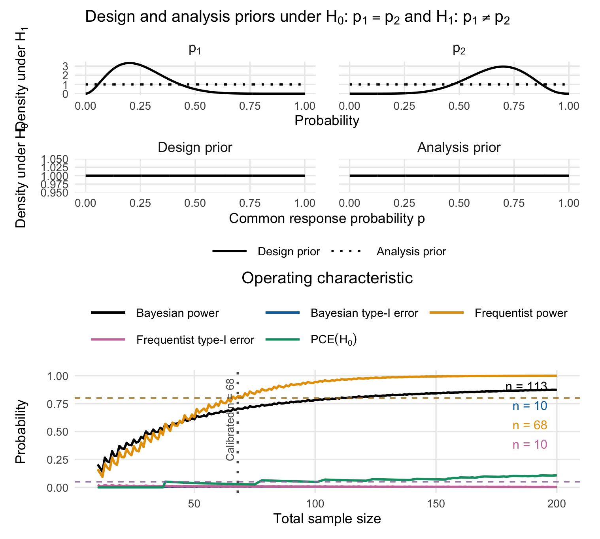
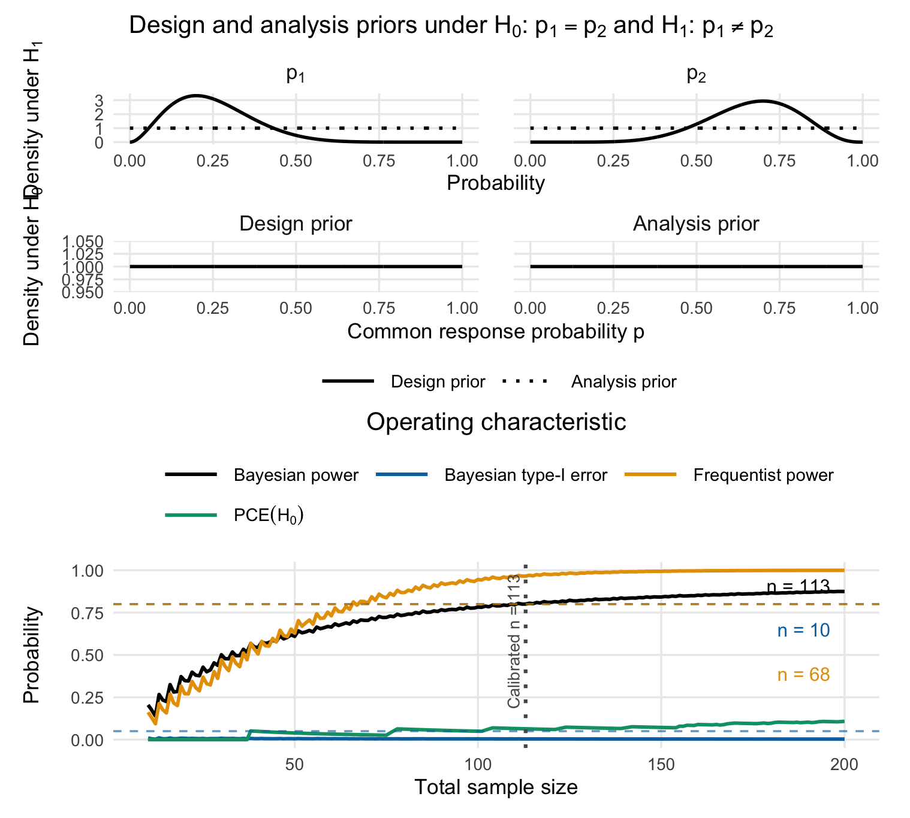

```{r setup, include = FALSE}
knitr::opts_chunk$set(
  collapse = TRUE,
  comment = "#>",
  fig.width = 7,
  fig.height = 5,
  dpi = 100,
  fig.retina = 1,
  dev = "png"
)
options(bfbin2arm.ncores = 1L)
library(bfbin2arm)
```

# Scope

This vignette deals exclusively with the two-sided Bayes factor test

$$
H_0:p_1=p_2 \qquad \text{versus} \qquad H_1:p_1\neq p_2,
$$

where $p_1$ and $p_2$ denote the event probabilities in the control and treatment arms. We write $\mathrm{BF}_{01}$ for the marginal likelihood under the common-probability null divided by the marginal likelihood under the unequal-probability alternative. Small values support $H_1$ and large values support $H_0$.

Directional tests are covered by a separate vignette. They require additional choices about whether effects in the unexpected direction are excluded a priori or included in a composite null, as well as truncated priors and hypothesis-specific normalising constants. Keeping the examples separate makes the prior specification, decision rule, and operating characteristics of the two-sided test transparent.

# Model and priors

Let

$$
Y_1\sim\operatorname{Bin}(n_1,p_1),\qquad
Y_2\sim\operatorname{Bin}(n_2,p_2),
$$

independently. Under $H_0$, a common response probability is assigned a beta prior,

$$
p_1=p_2=p\mid H_0\sim\operatorname{Beta}(a_0,b_0).
$$

Under $H_1$, independent beta priors are assigned to the arm-specific probabilities,

$$
p_1\mid H_1\sim\operatorname{Beta}(a_1,b_1),\qquad
p_2\mid H_1\sim\operatorname{Beta}(a_2,b_2).
$$

The package distinguishes **analysis priors**, which determine the Bayes factor applied to the observed data, from **design priors**, which average the operating characteristics at the planning stage. The two sets of priors may be identical, but they need not be.

For beta analysis priors, the Bayes factor is

$$
\mathrm{BF}_{01}(y_1,y_2)=
\frac{\mathrm{B}(a_0^a+y_1+y_2,b_0^a+n_1+n_2-y_1-y_2)}
     {\mathrm{B}(a_0^a,b_0^a)}
\frac{\mathrm{B}(a_1^a,b_1^a)\mathrm{B}(a_2^a,b_2^a)}
     {\mathrm{B}(a_1^a+y_1,b_1^a+n_1-y_1)
      \mathrm{B}(a_2^a+y_2,b_2^a+n_2-y_2)}.
$$

The function `twoarmbinbf01()` evaluates this expression. The functions `powertwoarmbinbf01()` and `design_twoarm_onestage_bf()` compute exact operating characteristics by summing over all possible pairs $(y_1,y_2)$; no Monte Carlo simulation is needed.

# Evidence and calibration

For an evidence threshold $k<1$, the efficacy region is

$$
\mathcal{R}_k=\{(y_1,y_2):\mathrm{BF}_{01}(y_1,y_2)<k\}.
$$

The package reports the design-prior predictive probability of this region under $H_1$ as `Power` and under $H_0$ as `Type1_Error`. For a threshold $k_f>1$, `CE_H0` is the predictive probability that $\mathrm{BF}_{01}>k_f$ under $H_0$. Optional frequentist operating characteristics are obtained by summing over the same evidence region at fixed values of $(p_1,p_2)$.

The examples use $k=1/10$ and $k_f=10$ for strong evidence. Other thresholds should be prespecified and examined in sensitivity analyses.

# Example 1: CONSIDER - a two-sided example with balanced allocation

The CONSIDER trial was a multicentre, randomised, double-blind, placebo-controlled phase II trial of canakinumab in adult-onset Still's disease [@kedor2020consider]. Its binary primary endpoint was a clinically relevant reduction in disease activity at week 12, defined by a decrease in DAS28 greater than 1.2. Recruitment ended early. The efficacy analysis contained 17 placebo patients and 18 canakinumab patients; 7 and 12, respectively, met the primary endpoint.

## Observed Bayes factor

We code placebo as arm 1 and canakinumab as arm 2.

```{r consider-data}
y1_consider <- 7L
n1_consider <- 17L
y2_consider <- 12L
n2_consider <- 18L

bf01_consider <- twoarmbinbf01(
  y1 = y1_consider,
  y2 = y2_consider,
  n1 = n1_consider,
  n2 = n2_consider,
  a_0_a = 1, b_0_a = 1,
  a_1_a = 1, b_1_a = 1,
  a_2_a = 1, b_2_a = 1
)

bf01_consider
1 / bf01_consider
```

With uniform analysis priors, $\mathrm{BF}_{01}$ is about 0.845, or $\mathrm{BF}_{10}$ about 1.18. The observed data therefore provide little evidence for either equality or inequality.

## Operating characteristics

The protocol assumed a placebo event probability no larger than 0.25 and a canakinumab event probability at least 0.67. As an illustration, we encode these expectations by $\operatorname{Beta}(3,9)$ and $\operatorname{Beta}(8,4)$ design priors under $H_1$. Their means are 0.25 and 0.667. Uniform analysis priors are retained.

```{r consider-oc}
oc_consider <- powertwoarmbinbf01(
  n1 = n1_consider,
  n2 = n2_consider,
  k = 1/10,
  k_f = 10,
  test = "BF01",
  a_0_d = 1, b_0_d = 1,
  a_0_a = 1, b_0_a = 1,
  a_1_d = 3, b_1_d = 9,
  a_2_d = 8, b_2_d = 4,
  a_1_a = 1, b_1_a = 1,
  a_2_a = 1, b_2_a = 1,
  compute_freq_t1e = TRUE,
  p1_power = 0.25,
  p2_power = 2/3,
  output = "numeric"
)

oc_consider
```

The call reports the exact operating characteristics at the achieved sample sizes. Changing only `n1` and `n2` to 34 evaluates the sample size originally planned per arm.

```{r consider-planned-oc}
oc_consider_planned <- powertwoarmbinbf01(
  n1 = 34,
  n2 = 34,
  k = 1/10,
  k_f = 10,
  test = "BF01",
  a_0_d = 1, b_0_d = 1,
  a_0_a = 1, b_0_a = 1,
  a_1_d = 3, b_1_d = 9,
  a_2_d = 8, b_2_d = 4,
  a_1_a = 1, b_1_a = 1,
  a_2_a = 1, b_2_a = 1,
  compute_freq_t1e = TRUE,
  p1_power = 0.25,
  p2_power = 2/3,
  output = "numeric"
)

oc_consider_planned
```
## Comparing calibration approaches

We now determine the required sample size prospectively using four
different calibration approaches. All four examples use the same
two-sided Bayes-factor test, analysis priors, design priors, evidence
threshold, allocation ratio, and sample-size search range. Only the
operating-characteristic constraints used to select the design differ.

The hypotheses are

\[
H_0:p_1=p_2
\qquad\text{versus}\qquad
H_1:p_1\neq p_2,
\]

where group 1 denotes placebo and group 2 denotes canakinumab. Evidence
against \(H_0\) is declared when
\(\operatorname{BF}_{01}<1/10\).

For the Bayesian operating characteristics, we retain the illustrative
design priors

\[
p\mid H_0\sim\operatorname{Beta}(1,1),
\]

and

\[
p_1\mid H_1\sim\operatorname{Beta}(3,9),
\qquad
p_2\mid H_1\sim\operatorname{Beta}(8,4),
\]

independently. Although these design priors favour a treatment benefit,
they are not truncated: both directions of a difference remain possible,
and the hypothesis test remains two-sided. Uniform analysis priors are
used under both models.

Frequentist power is evaluated at the fixed alternative
\((p_1,p_2)=(0.25,2/3)\). Frequentist type-I error is evaluated over a grid
of common event probabilities under \(H_0\).

Throughout this section, “frequentist calibration” refers to calibrating
the frequentist operating characteristics of the same Bayes-factor
decision rule, not replacing it with a conventional frequentist test.

```{r consider-calibration-package}
library(bfbin2arm)
```

### Frequentist calibration

The first design requires at least 80% frequentist power at the
prespecified alternative and a frequentist type-I-error rate no larger
than 5% over the supplied null grid.

The relevant targets are `target_freq_power` and `target_freq_type1`.
Bayesian operating characteristics are also calculated, but they do not
determine feasibility in this calibration.

```{r consider-frequentist-calibration, cache=TRUE, eval = FALSE}
consider_frequentist <- design_twoarm_onestage_bf(
  n_min = 10,
  n_max = 200,
  algorithm = "optimal",

  # Two-sided Bayes-factor decision rule
  test = "BF01",
  k = 1/10,
  k_f = 10,

  # Enforce frequentist power and frequentist type-I error
  calibration = "frequentist",
  target_freq_power = 0.80,
  target_freq_type1 = 0.05,

  # No additional compelling-evidence constraint
  target_ce_h0 = 0,

  # Design and analysis priors under H0
  a_0_d = 1, b_0_d = 1,
  a_0_a = 1, b_0_a = 1,

  # Design priors under H1
  a_1_d = 3, b_1_d = 9,
  a_2_d = 8, b_2_d = 4,

  # Analysis priors under H1
  a_1_a = 1, b_1_a = 1,
  a_2_a = 1, b_2_a = 1,

  # Fixed alternative for frequentist power
  p1_power = 0.25,
  p2_power = 2/3,

  # Identical grids ensure evaluation along p1 = p2
  p1_grid = seq(0, 1, by = 0.02),
  p2_grid = seq(0, 1, by = 0.02),

  # Equal allocation and sustained feasibility
  alloc1 = 0.5,
  alloc2 = 0.5,
  sustain_n = 10L,
  power_cushion = 0,

  report_freq_type1 = TRUE,
  progress = FALSE
)
```
We print the results:
```{r, eval = FALSE}
print(consider_frequentist)
```
```
One-stage two-arm Bayes factor design
------------------------------------
Mode: optimal
Status: Smallest feasible one-stage two-arm design found.
Calibration: frequentist
Optional freq. Type-I reporting: on
Design: n_total = 68, n1 = 34, n2 = 34

Operating characteristics
 Power = 0.7066
 Type-I error = 0.0056
 CE(H0) = 0.0290
 Freq. Type-I = 0.0085
 Freq. Power = 0.8164
```

This design is selected using frequentist criteria only. Its Bayesian
power need not reach 80%, even when its frequentist power does.

```{r, eval = FALSE}
plot(consider_frequentist)
```
```{r echo = FALSE, out.width = "80%", fig.align = "center", fig.cap = "Figure 1: Visualization of the calibrated two-arm one-stage phase II design with a binary endpoint based on 5% frequentist type-I-error and 80% power."}

```

### Bayesian calibration

The second design requires at least 80% Bayesian power and a Bayesian
type-I-error rate no larger than 5%. These quantities average rejection
probabilities over the respective design priors.

The relevant targets are now `target_power` and `target_type1`.
Setting `report_freq_type1 = TRUE` additionally requests frequentist
type-I-error reporting at the selected design, without making it a
Bayesian calibration constraint. Supplying `p1_power` and `p2_power`
also allows frequentist power to be reported.

```{r consider-bayesian-calibration, cache=TRUE, eval = FALSE}
consider_bayesian <- design_twoarm_onestage_bf(
  n_min = 10,
  n_max = 200,
  algorithm = "optimal",

  # Two-sided Bayes-factor decision rule
  test = "BF01",
  k = 1/10,
  k_f = 10,

  # Enforce Bayesian power and Bayesian type-I error
  calibration = "Bayesian",
  target_power = 0.80,
  target_type1 = 0.05,

  # No additional compelling-evidence constraint
  target_ce_h0 = 0,

  # Design and analysis priors under H0
  a_0_d = 1, b_0_d = 1,
  a_0_a = 1, b_0_a = 1,

  # Design priors under H1
  a_1_d = 3, b_1_d = 9,
  a_2_d = 8, b_2_d = 4,

  # Analysis priors under H1
  a_1_a = 1, b_1_a = 1,
  a_2_a = 1, b_2_a = 1,

  # Report frequentist power at this alternative
  p1_power = 0.25,
  p2_power = 2/3,

  # Null grid used for final frequentist T1E reporting
  p1_grid = seq(0, 1, by = 0.02),
  p2_grid = seq(0, 1, by = 0.02),

  # Equal allocation and sustained feasibility
  alloc1 = 0.5,
  alloc2 = 0.5,
  sustain_n = 10L,
  power_cushion = 0,

  report_freq_type1 = TRUE,
  progress = FALSE
)

print(consider_bayesian)
```
```
One-stage two-arm Bayes factor design
------------------------------------
Mode: optimal
Status: Smallest feasible one-stage two-arm design found.
Calibration: Bayesian
Optional freq. Type-I reporting: on
Design: n_total = 113, n1 = 56, n2 = 57

Operating characteristics
 Power = 0.8002
 Type-I error = 0.0041
 CE(H0) = 0.0639
 Freq. Type-I = 0.0058
 Freq. Power = 0.9651
```

The selected design satisfies the Bayesian requirements. The reported
frequentist operating characteristics are diagnostic: they are not
constraints in this search.

```{r, eval = FALSE}
plot(consider_bayesian)
```
```{r echo = FALSE, out.width = "80%", fig.align = "center", fig.cap = "Figure 1: Visualization of the calibrated two-arm one-stage phase II design with a binary endpoint based on 5% Bayesian type-I-error and 80% Bayesian power."}

```

### Hybrid calibration

The third design combines at least 80% Bayesian power with a frequentist
type-I-error rate no larger than 5% over the null grid.

Accordingly, the relevant targets are `target_power` and
`target_freq_type1`. Neither Bayesian type-I error nor frequentist power
is an active constraint.

```{r consider-hybrid-calibration, cache=TRUE, eval = FALSE}
consider_hybrid <- design_twoarm_onestage_bf(
  n_min = 10,
  n_max = 200,
  algorithm = "optimal",

  # Two-sided Bayes-factor decision rule
  test = "BF01",
  k = 1/10,
  k_f = 10,

  # Enforce Bayesian power and frequentist type-I error
  calibration = "hybrid",
  target_power = 0.80,
  target_freq_type1 = 0.05,

  # No additional compelling-evidence constraint
  target_ce_h0 = 0,

  # Design and analysis priors under H0
  a_0_d = 1, b_0_d = 1,
  a_0_a = 1, b_0_a = 1,

  # Design priors under H1
  a_1_d = 3, b_1_d = 9,
  a_2_d = 8, b_2_d = 4,

  # Analysis priors under H1
  a_1_a = 1, b_1_a = 1,
  a_2_a = 1, b_2_a = 1,

  # Report frequentist power at this alternative
  p1_power = 0.25,
  p2_power = 2/3,

  # Null grid for frequentist type-I-error calibration
  p1_grid = seq(0, 1, by = 0.02),
  p2_grid = seq(0, 1, by = 0.02),

  # Equal allocation and sustained feasibility
  alloc1 = 0.5,
  alloc2 = 0.5,
  sustain_n = 10L,
  power_cushion = 0,

  report_freq_type1 = TRUE,
  progress = FALSE
)

print(consider_hybrid)
```
```
One-stage two-arm Bayes factor design
------------------------------------
Mode: optimal
Status: Smallest feasible one-stage two-arm design found.
Calibration: hybrid
Optional freq. Type-I reporting: on
Design: n_total = 113, n1 = 56, n2 = 57

Operating characteristics
 Power = 0.8002
 Type-I error = 0.0041
 CE(H0) = 0.0639
 Freq. Type-I = 0.0058
 Freq. Power = 0.9651
```

This calibration is useful when power is defined prospectively through
a design prior, while type-I-error control is assessed conditionally over
the null parameter space.

### Full calibration

The fourth design simultaneously requires:

- Bayesian power of at least 80%.
- Frequentist power of at least 80% at the specified alternative.
- Bayesian type-I-error rate no larger than 5%.
- Frequentist type-I-error rate no larger than 5% over the null grid.

All four targets are therefore supplied explicitly.

```{r consider-full-calibration, cache=TRUE, eval = FALSE}
consider_full <- design_twoarm_onestage_bf(
  n_min = 10,
  n_max = 200,
  algorithm = "optimal",

  # Two-sided Bayes-factor decision rule
  test = "BF01",
  k = 1/10,
  k_f = 10,

  # Enforce both Bayesian and frequentist requirements
  calibration = "full",
  target_power = 0.80,
  target_type1 = 0.05,
  target_freq_power = 0.80,
  target_freq_type1 = 0.05,

  # No additional compelling-evidence constraint
  target_ce_h0 = 0,

  # Design and analysis priors under H0
  a_0_d = 1, b_0_d = 1,
  a_0_a = 1, b_0_a = 1,

  # Design priors under H1
  a_1_d = 3, b_1_d = 9,
  a_2_d = 8, b_2_d = 4,

  # Analysis priors under H1
  a_1_a = 1, b_1_a = 1,
  a_2_a = 1, b_2_a = 1,

  # Fixed alternative for frequentist power
  p1_power = 0.25,
  p2_power = 2/3,

  # Null grid for frequentist type-I-error calibration
  p1_grid = seq(0, 1, by = 0.02),
  p2_grid = seq(0, 1, by = 0.02),

  # Equal allocation and sustained feasibility
  alloc1 = 0.5,
  alloc2 = 0.5,
  sustain_n = 10L,
  power_cushion = 0,

  report_freq_type1 = TRUE,
  progress = FALSE
)

print(consider_full)
```
```
One-stage two-arm Bayes factor design
------------------------------------
Mode: optimal
Status: Smallest feasible one-stage two-arm design found.
Calibration: full
Optional freq. Type-I reporting: on
Design: n_total = 113, n1 = 56, n2 = 57

Operating characteristics
 Power = 0.8002
 Type-I error = 0.0041
 CE(H0) = 0.0639
 Freq. Type-I = 0.0058
 Freq. Power = 0.9651
```

Under identical search settings, the full calibration cannot select a
smaller feasible sample size than any of the other three calibrations:
its feasible set is their intersection. However, two or more modes may
select the same design if the additional constraints are already
satisfied at that sample size.

### Comparing selected designs

Having run each calibration separately, we see that in this case, Bayesian, hybrid and full calibration yield the same designs. This is, of course, not always the case.

### Sustained-feasibility diagnostics

Each example uses `sustain_n = 10L`. Consequently, the calibration checks
the relevant constraints at the candidate total sample size and over a
forward window of ten additional candidate total sample sizes, within
the search range.

### Interpreting frequentist error control

The reported frequentist type-I error is the maximum over the supplied
null grid. It approximates, but does not certify, the supremum over the
continuous interval \(p\in[0,1]\). A finer grid or continuous maximisation
should therefore be used when stricter numerical verification is
required.

Likewise, the 80% frequentist power requirement applies to the specified
alternative \((0.25,2/3)\), not to every possible unequal pair of event
probabilities. Bayesian power instead averages over the entire
alternative design prior.

The design priors should represent defensible pretrial uncertainty.
They should not be made more concentrated merely to obtain a smaller
required sample size.

# Example 2: NADIM II - a two-sided example with unequal allocation

## Trial setting and observed data

NADIM II was a randomized phase II trial in resectable stage IIIA/IIIB
non-small-cell lung cancer. Its experimental:control allocation was 2:1
[@provencio2023nadimii]. The primary binary endpoint was pathological
complete response after neoadjuvant treatment. The experimental regimen
added nivolumab to chemotherapy; control patients received chemotherapy
alone [@provencio2023nadimii].

The reported primary-analysis counts were 21 responses among 57
experimental patients and 2 among 29 control patients. Patients who did
not undergo surgery were counted as nonresponders, rather than removed
from these denominators [@provencio2023nadimii]. The original publication
reported two-sided tests [@provencio2023nadimii].

Here and throughout the code, **arm 1 is control and arm 2 is experimental**.
Thus the trial's 2:1 experimental:control allocation corresponds to
`alloc1 = 1/3` and `alloc2 = 2/3`.

```{r nadim-data}
library(bfbin2arm)

y1_nadim <- 2L
n1_nadim <- 29L
y2_nadim <- 21L
n2_nadim <- 57L

nadim_observed <- data.frame(
  Arm = c("Control: chemotherapy", "Experimental: nivolumab + chemotherapy"),
  Responses = c(y1_nadim, y2_nadim),
  Patients = c(n1_nadim, n2_nadim),
  Response_rate = c(y1_nadim / n1_nadim, y2_nadim / n2_nadim)
)

knitr::kable(nadim_observed, digits = 4)
```

## Two-sided Bayes-factor analysis

We compare

\[
H_0:p_1=p_2
\qquad\text{versus}\qquad
H_1:p_1\neq p_2.
\]

The analysis priors are \(p\mid H_0\sim\operatorname{Beta}(1,1)\) and,
independently, \(p_1,p_2\mid H_1\sim\operatorname{Beta}(1,1)\). Evidence
against \(H_0\) is declared when \(\operatorname{BF}_{01}<0.1\).
This is a trial-inspired Bayesian reanalysis, not a reconstruction of the
original frequentist test.

```{r nadim-bayes-factor}
bf01_nadim <- twoarmbinbf01(
  y1 = y1_nadim, y2 = y2_nadim,
  n1 = n1_nadim, n2 = n2_nadim,
  a_0_a = 1, b_0_a = 1,
  a_1_a = 1, b_1_a = 1,
  a_2_a = 1, b_2_a = 1
)

# Independent log-scale check; binomial coefficients cancel.
log_bf01_nadim <-
  lbeta(1 + y1_nadim + y2_nadim,
        1 + n1_nadim + n2_nadim - y1_nadim - y2_nadim) -
  lbeta(1 + y1_nadim, 1 + n1_nadim - y1_nadim) -
  lbeta(1 + y2_nadim, 1 + n2_nadim - y2_nadim)

stopifnot(
  is.finite(bf01_nadim),
  isTRUE(all.equal(bf01_nadim, exp(log_bf01_nadim), tolerance = 1e-10))
)

c(
  BF01 = bf01_nadim,
  BF10 = 1 / bf01_nadim,
  risk_difference = y2_nadim / n2_nadim - y1_nadim / n1_nadim
)
```

The resulting \(\operatorname{BF}_{01}\) is approximately
`r formatC(bf01_nadim, digits = 4, format = "f")`, corresponding to
\(\operatorname{BF}_{10}\) of approximately
`r formatC(1 / bf01_nadim, digits = 1, format = "f")`.
The Bayes factor supports unequal response probabilities. The observed
rates indicate which arm has the higher response rate; a two-sided
Bayes factor alone is not a directional test.

## Prospective planning assumptions

The original trial's sample-size calculation assumed response
probabilities of 0.10 under control and 0.40 under experimental treatment,
80% power, 5% alpha, and a planned sample of 90 allowing for 15% dropout
[@provencio2023nadimii]. We use those *planning probabilities*, not the
observed response rates, to construct a prospective-design illustration.

For frequentist power, the fixed alternative is
\((p_1,p_2)=(0.10,0.40)\). For Bayesian power we use independent design
priors

\[
p_1\mid H_1\sim\operatorname{Beta}(2,18),
\qquad
p_2\mid H_1\sim\operatorname{Beta}(8,12).
\]

Their means are 0.10 and 0.40 and their beta concentration parameters
\(a+b\) are both 20. **The concentration 20 is an illustrative choice for
this vignette, not a prior specification from the NADIM II protocol.**
It should be varied in sensitivity analyses. The priors are not
truncated to \(p_2>p_1\); the test remains two-sided.

Under \(H_0\), the common response probability has the uniform design
prior \(p\sim\operatorname{Beta}(1,1)\). This is also an illustrative
choice, retained for comparability with the preceding example; it is
not inferred from the pooled NADIM II data. Analysis priors remain
uniform in every calibration. Consequently, design-prior information
enters predictive operating characteristics, not the Bayes factor as
borrowed historical observations.

All four calibrations below use \(k=0.1\), a fixed 1:2
control:experimental allocation, and a search over **total** sample sizes
from 12 to 240. The ceiling is a bounded teaching example, not a claim
that all possible prior specifications are feasible within this range.
With `sustain_n = 10L`, the relevant constraints must hold at the candidate
total and at the next ten candidate totals, subject to the search range.
The package documents these arguments and the four calibration modes in
its [reference manual](https://cran.rstudio.com/web/packages/bfbin2arm/bfbin2arm.pdf).

| Calibration | Power requirement | Type-I-error requirement |
|:--|:--|:--|
| Frequentist | Frequentist power at least 0.80 | Frequentist T1E at most 0.05 |
| Bayesian | Bayesian power at least 0.80 | Bayesian T1E at most 0.05 |
| Hybrid | Bayesian power at least 0.80 | Frequentist T1E at most 0.05 |
| Full | Both power definitions at least 0.80 | Both T1E definitions at most 0.05 |

In every example, `target_ce_h0 = 0` switches off an additional constraint
on compelling evidence for the null. `k_f = 10` is retained to calculate
that diagnostic probability. Frequentist calibration refers to the
frequentist operating characteristics of the *same Bayes-factor rule*,
not to replacing it with a chi-square or Fisher test.

## Frequentist calibration with 1:2 allocation

This first call enforces frequentist power at the original planning
alternative and frequentist type-I-error control over a common-probability
grid under \(H_0\). Bayesian operating characteristics are reported but are
not feasibility constraints.

```{r, echo = FALSE}
nadim_frequentist <- readRDS("nadimII-freq.rds")
```
```{r nadim-frequentist-calibration, cache=TRUE, eval = FALSE}
nadim_frequentist <- design_twoarm_onestage_bf(
  n_min = 12, n_max = 240,
  algorithm = "optimal",
  test = "BF01", k = 1/10, k_f = 3,

  calibration = "frequentist",
  target_freq_power = 0.80,
  target_freq_type1 = 0.05,
  target_ce_h0 = 0,

  # Uniform null design and analysis priors
  a_0_d = 1, b_0_d = 1,
  a_0_a = 1, b_0_a = 1,

  # Alternative design priors: means 0.10 and 0.40
  a_1_d = 2*2, b_1_d = 18*2,
  a_2_d = 8*2, b_2_d = 12*2,

  # Uniform alternative analysis priors
  a_1_a = 1, b_1_a = 1,
  a_2_a = 1, b_2_a = 1,

  p1_power = 0.10, p2_power = 0.40,
  p1_grid = seq(0, 1, by = 0.02),
  p2_grid = seq(0, 1, by = 0.02),

  # Arm 1 = control; arm 2 = experimental
  alloc1 = 1/3, alloc2 = 2/3,
  sustain_n = 10L, power_cushion = 0,
  report_freq_type1 = TRUE,
  progress = TRUE
)

summary(nadim_frequentist)
```
```
Summary: One-stage two-arm Bayes factor design
---------------------------------------------
Mode:        optimal
Status:      Smallest feasible one-stage two-arm design found.
Calibration: frequentist
Feasible:    yes

Search overview
  n evaluated          = 229
  pointwise feasible   = 121
  sustained feasible   = 120
  first pointwise n    = 119
  first sustained n    = 121

Selected design
  n_total = 121, n1 = 40, n2 = 81
```

## Bayesian calibration with 1:2 allocation

The second call enforces prior-predictive power and prior-predictive
type-I error under the stated beta design priors. The supplied fixed
alternative and null grid are used for additional reporting, not as
Bayesian feasibility constraints.

```{r, echo = FALSE}
nadim_bayesian <- readRDS("nadimII-bayesian.rds")
```
```{r nadim-bayesian-calibration, cache=TRUE, eval = FALSE}
nadim_bayesian <- design_twoarm_onestage_bf(
  n_min = 12, n_max = 240,
  algorithm = "optimal",
  test = "BF01", k = 1/10, k_f = 3,

  calibration = "Bayesian",
  target_power = 0.80,
  target_type1 = 0.05,
  target_ce_h0 = 0,

  a_0_d = 1, b_0_d = 1,
  a_0_a = 1, b_0_a = 1,
  a_1_d = 2, b_1_d = 18,
  a_2_d = 8, b_2_d = 12,
  a_1_a = 1, b_1_a = 1,
  a_2_a = 1, b_2_a = 1,

  # Reporting only; not Bayesian calibration constraints
  p1_power = 0.10, p2_power = 0.40,
  p1_grid = seq(0, 1, by = 0.02),
  p2_grid = seq(0, 1, by = 0.02),

  alloc1 = 1/3, alloc2 = 2/3,
  sustain_n = 10L, power_cushion = 0,
  report_freq_type1 = TRUE,
  progress = TRUE
)

summary(nadim_bayesian)
```
```
Summary: One-stage two-arm Bayes factor design
---------------------------------------------
Mode:        optimal
Status:      Smallest feasible one-stage two-arm design found.
Calibration: Bayesian
Feasible:    yes

Search overview
  n evaluated          = 229
  pointwise feasible   = 54
  sustained feasible   = 54
  first pointwise n    = 187
  first sustained n    = 187

Selected design
  n_total = 187, n1 = 62, n2 = 125
```

## Hybrid calibration with 1:2 allocation

The hybrid call combines Bayesian power with frequentist type-I-error
control. Frequentist power and Bayesian type-I error are diagnostics,
not active constraints.

```{r, echo = FALSE}
nadim_hybrid <- readRDS("nadimII-hybrid.rds")
```
```{r nadim-hybrid-calibration, cache=TRUE, eval = FALSE}
nadim_hybrid <- design_twoarm_onestage_bf(
  n_min = 12, n_max = 240,
  algorithm = "optimal",
  test = "BF01", k = 1/10, k_f = 10,

  calibration = "hybrid",
  target_power = 0.80,
  target_freq_type1 = 0.05,
  target_ce_h0 = 0,

  a_0_d = 1, b_0_d = 1,
  a_0_a = 1, b_0_a = 1,
  a_1_d = 2, b_1_d = 18,
  a_2_d = 8, b_2_d = 12,
  a_1_a = 1, b_1_a = 1,
  a_2_a = 1, b_2_a = 1,

  p1_power = 0.10, p2_power = 0.40,
  p1_grid = seq(0, 1, by = 0.02),
  p2_grid = seq(0, 1, by = 0.02),

  alloc1 = 1/3, alloc2 = 2/3,
  sustain_n = 10L, power_cushion = 0,
  report_freq_type1 = TRUE,
  progress = FALSE
)

summary(nadim_hybrid)
```
```
Summary: One-stage two-arm Bayes factor design
---------------------------------------------
Mode:        optimal
Status:      Smallest feasible one-stage two-arm design found.
Calibration: hybrid
Feasible:    yes

Search overview
  n evaluated          = 229
  pointwise feasible   = 54
  sustained feasible   = 54
  first pointwise n    = 187
  first sustained n    = 187

Selected design
  n_total = 187, n1 = 62, n2 = 125
```


## Full calibration with 1:2 allocation

The final unequal-allocation call enforces both power definitions and
both type-I-error definitions simultaneously. Every enforced target is
specified explicitly.

```{r, echo = FALSE}
nadim_full <- readRDS("nadimII-full.rds")
```
```{r nadim-full-calibration, cache=TRUE, eval = FALSE}
nadim_full <- design_twoarm_onestage_bf(
  n_min = 12, n_max = 240,
  algorithm = "optimal",
  test = "BF01", k = 1/10, k_f = 10,

  calibration = "full",
  target_power = 0.80,
  target_type1 = 0.05,
  target_freq_power = 0.80,
  target_freq_type1 = 0.05,
  target_ce_h0 = 0,

  a_0_d = 1, b_0_d = 1,
  a_0_a = 1, b_0_a = 1,
  a_1_d = 2, b_1_d = 18,
  a_2_d = 8, b_2_d = 12,
  a_1_a = 1, b_1_a = 1,
  a_2_a = 1, b_2_a = 1,

  p1_power = 0.10, p2_power = 0.40,
  p1_grid = seq(0, 1, by = 0.02),
  p2_grid = seq(0, 1, by = 0.02),

  alloc1 = 1/3, alloc2 = 2/3,
  sustain_n = 10L, power_cushion = 0,
  report_freq_type1 = TRUE,
  progress = FALSE
)

summary(nadim_full)
```
```
Summary: One-stage two-arm Bayes factor design
---------------------------------------------
Mode:        optimal
Status:      Smallest feasible one-stage two-arm design found.
Calibration: full
Feasible:    yes

Search overview
  n evaluated          = 229
  pointwise feasible   = 54
  sustained feasible   = 54
  first pointwise n    = 187
  first sustained n    = 187

Selected design
  n_total = 187, n1 = 62, n2 = 125
```

## Comparing selected designs

Only after making the four individual design calls do we collect the
results for reporting. No additional calibration is performed here.

```{r nadim-calibration-comparison}
nadim_designs <- list(
  Frequentist = nadim_frequentist,
  Bayesian = nadim_bayesian,
  Hybrid = nadim_hybrid,
  Full = nadim_full
)

nadim_comparison <- do.call(rbind, lapply(names(nadim_designs), function(nm) {
  x <- nadim_designs[[nm]]
  out <- data.frame(
    Calibration = nm,
    Feasible = isTRUE(x$feasible),
    N_total = NA_real_, n_control = NA_real_, n_experimental = NA_real_,
    Bayesian_power = NA_real_, Bayesian_T1E = NA_real_,
    Frequentist_power = NA_real_, Frequentist_T1E_grid = NA_real_,
    PCE_H0 = NA_real_
  )

  if (isTRUE(x$feasible) && !is.null(x$operating_characteristics)) {
    oc <- x$operating_characteristics
    out$N_total <- unname(x$design["n_total"])
    out$n_control <- unname(x$design["n1"])
    out$n_experimental <- unname(x$design["n2"])
    out$Bayesian_power <- oc$power
    out$Bayesian_T1E <- oc$type1
    out$Frequentist_power <- oc$freq_power
    out$Frequentist_T1E_grid <- oc$freq_type1
    out$PCE_H0 <- oc$ce_h0
  }
  out
}))

rownames(nadim_comparison) <- NULL

knitr::kable(
  nadim_comparison[c("Calibration", "Feasible", "N_total",
                     "n_control", "n_experimental")],
  caption = "Selected NADIM II-inspired designs with 1:2 control:experimental allocation."
)

knitr::kable(
  nadim_comparison[c("Calibration", "Bayesian_power", "Bayesian_T1E",
                     "Frequentist_power", "Frequentist_T1E_grid", "PCE_H0")],
  digits = 4,
  caption = "Operating characteristics at each selected design."
)

# A selected design near n_max may have a truncated forward window.
for (nm in names(nadim_designs)) {
  x <- nadim_designs[[nm]]
  if (isTRUE(x$feasible) &&
      unname(x$design["n_total"]) + x$inputs$sustain_n > x$inputs$n_max) {
    warning(nm, ": increase n_max to check the complete sustained-feasibility window.",
            call. = FALSE)
  }
}
```

All selected sample sizes are totals across both arms. Arm sizes are
rounded to integers, so the resulting ratio need not be exactly 1:2.
The package conditions its calculations on the selected arm sizes; it
does not additionally average over random allocation-count imbalance.
If exact 1:2 counts are required, a suitable total divisible by three
must be chosen and its operating characteristics re-evaluated.

A design may satisfy frequentist power at \((0.10,0.40)\) before it
satisfies Bayesian power, since the latter averages over uncertain
response probabilities, including smaller differences. Calibration
modes can therefore select different totals. Conversely, several modes
may select the same total when their additional constraints are already
satisfied. No sample-size saving is presumed for Bayesian calibration.

The frequentist type-I error shown is a maximum over the supplied grid,
not a certified supremum over the continuous null space. A finer grid
or continuous maximisation is needed for stricter numerical verification.
The 80% frequentist power target is pointwise at the specified alternative.
`PCE_H0` is reported but not constrained.

These totals concern participants with binary outcomes defined according
to the analysis strategy. They are not directly comparable to the original
planned recruitment target of 90 without considering its dropout
allowance, different testing rule, and outcome-handling assumptions.
Failure to undergo surgery is an endpoint failure in this illustration,
not automatically a missing outcome warranting dropout inflation.

## Optional: isolate the allocation effect

To study unequal allocation rather than confound it with the calibration
mode, repeat the **full** calibration under equal allocation, changing
only `alloc1` and `alloc2`.

```{r, echo = FALSE}
nadim_full_balanced <- readRDS("~/Library/Mobile Documents/com~apple~CloudDocs/Documents/bfbin2arm/vignettes/nadimII-full_balanced.rds")
```
```{r nadim-balanced-full-calibration, eval=FALSE, cache=TRUE}
nadim_full_balanced <- design_twoarm_onestage_bf(
  n_min = 12, n_max = 240,
  algorithm = "optimal",
  test = "BF01", k = 1/10, k_f = 10,

  calibration = "full",
  target_power = 0.80,
  target_type1 = 0.05,
  target_freq_power = 0.80,
  target_freq_type1 = 0.05,
  target_ce_h0 = 0,

  a_0_d = 1, b_0_d = 1,
  a_0_a = 1, b_0_a = 1,
  a_1_d = 2, b_1_d = 18,
  a_2_d = 8, b_2_d = 12,
  a_1_a = 1, b_1_a = 1,
  a_2_a = 1, b_2_a = 1,

  p1_power = 0.10, p2_power = 0.40,
  p1_grid = seq(0, 1, by = 0.02),
  p2_grid = seq(0, 1, by = 0.02),

  # Only substantive change: equal instead of unequal allocation
  alloc1 = 0.5, alloc2 = 0.5,
  sustain_n = 10L, power_cushion = 0,
  report_freq_type1 = TRUE,
  progress = FALSE
)

summary(nadim_full_balanced)
```
```
Summary: One-stage two-arm Bayes factor design
---------------------------------------------
Mode:        optimal
Status:      Smallest feasible one-stage two-arm design found.
Calibration: full
Feasible:    yes

Search overview
  n evaluated          = 229
  pointwise feasible   = 80
  sustained feasible   = 80
  first pointwise n    = 161
  first sustained n    = 161

Selected design
  n_total = 161, n1 = 80, n2 = 81
```

```{r nadim-allocation-comparison, eval=TRUE}
if (isTRUE(nadim_full$feasible) && isTRUE(nadim_full_balanced$feasible)) {
  allocation_comparison <- data.frame(
    Allocation_control_experimental = c("1:1", "1:2"),
    N_total = c(unname(nadim_full_balanced$design["n_total"]),
                unname(nadim_full$design["n_total"])),
    n_control = c(unname(nadim_full_balanced$design["n1"]),
                  unname(nadim_full$design["n1"])),
    n_experimental = c(unname(nadim_full_balanced$design["n2"]),
                       unname(nadim_full$design["n2"]))
  )
  knitr::kable(allocation_comparison)
}
```

Unequal allocation is a supported design choice, not a guarantee of a
smaller total sample size. The benefit illustrated here is the ability
to calibrate the actual intended allocation and quantify its sample-size
and operating-characteristic implications without imposing balance.

## Joint sensitivity to the evidence threshold, design-prior concentration, and null-evidence requirement

We now investigate how the selected sample size depends on the evidence
threshold, uncertainty in the alternative design prior, and an additional
requirement on the probability of obtaining compelling evidence for the
null hypothesis.

This sensitivity analysis varies the concentration of the alternative
design priors to describe the consequences of different planning
assumptions. It does not justify choosing a more concentrated prior
merely to obtain a smaller sample size.

The alternative design priors have the common form

\[
p_1\mid H_1\sim\operatorname{Beta}(0.10s,0.90s),
\qquad
p_2\mid H_1\sim\operatorname{Beta}(0.40s,0.60s).
\]

Their means remain 0.10 and 0.40, while the concentration \(s=a+b\)
controls their dispersion. We examine all six combinations of

\[
k\in\left\{\frac{1}{10},\frac{1}{3}\right\}
\qquad\text{and}\qquad
s\in\{20,50,100\}.
\]

Uniform analysis priors are retained in every scenario. Consequently,
changing \(s\) changes predictive operating characteristics but does not
change the Bayes-factor decision rule at a fixed sample size. In
particular, it does not change frequentist power or frequentist type-I
error at a fixed design.

The null design prior remains

\[
p\mid H_0\sim\operatorname{Beta}(1,1).
\]

All scenarios retain 1:2 control-to-experimental allocation, frequentist
power evaluation at \((p_1,p_2)=(0.10,0.40)\), and the same 80% power
targets and 5% type-I-error bounds.

For each scenario, we perform frequentist, hybrid, and full calibration
twice:

- Without an additional probability-of-compelling-evidence requirement.
- With the additional requirement

\[
\operatorname{PCE}(H_0)
=
P\!\left(\operatorname{BF}_{01}>10\mid H_0\right)
\geq 0.60.
\]

The threshold `k_f = 3` is held fixed throughout. Thus, the second
analysis requires a 60% predictive probability of obtaining at least
threefold evidence for equality under the null design prior.

This requirement is distinct from type-I-error control: avoiding false
positive conclusions does not imply that the trial frequently produces
strong evidence for equality.

### Sensitivity grid and computational settings

The complete sensitivity analysis comprises 36 searches: six
threshold–concentration combinations, three calibration modes, and two
PCE settings.

The default search range matches the preceding example and is
deliberately bounded. A scenario for which no feasible design is found
is reported as such; this does not establish that a feasible design
does not exist at larger sample sizes.

Adding a demanding null-evidence requirement can require a substantially
larger search range. Before increasing that range, the Bayes-factor and
predictive-probability calculations should use numerically stable
implementations.

```{r nadim-sensitivity-settings}
library(bfbin2arm)

nadim_sensitivity_scenarios <- data.frame(
  scenario_id = c(
    "k10_s20",
    "k10_s50",
    "k10_s100",
    "k3_s20",
    "k3_s50",
    "k3_s100"
  ),
  evidence_threshold = c(
    "1/10", "1/10", "1/10",
    "1/3",  "1/3",  "1/3"
  ),
  k = c(
    1/10, 1/10, 1/10,
    1/3,  1/3,  1/3
  ),
  concentration = c(
    20, 50, 100,
    20, 50, 100
  ),
  stringsAsFactors = FALSE
)

nadim_sensitivity_scenarios$a1 <-
  0.10 * nadim_sensitivity_scenarios$concentration

nadim_sensitivity_scenarios$b1 <-
  0.90 * nadim_sensitivity_scenarios$concentration

nadim_sensitivity_scenarios$a2 <-
  0.40 * nadim_sensitivity_scenarios$concentration

nadim_sensitivity_scenarios$b2 <-
  0.60 * nadim_sensitivity_scenarios$concentration

nadim_pce_requirements <- c(
  "No additional requirement" = 0,
  "PCE(H0) >= 0.60" = 0.60
)

nadim_sensitivity_n_min <- 12L
nadim_sensitivity_n_max <- 240L
nadim_sensitivity_sustain <- 10L
nadim_sensitivity_kf <- 3

knitr::kable(
  nadim_sensitivity_scenarios[
    c(
      "evidence_threshold",
      "concentration",
      "a1", "b1",
      "a2", "b2"
    )
  ],
  col.names = c(
    "k",
    "Concentration",
    "a1", "b1",
    "a2", "b2"
  ),
  caption = paste(
    "Alternative design-prior scenarios:",
    "two evidence thresholds and three prior concentrations."
  )
)
```

### Running the calibrations

Each calibration mode has its own explicit design-function call.
The loops repeat these calls across the six sensitivity scenarios and
the two null-evidence requirements.

When the PCE requirement is active, the first mode is more precisely
described as frequentist power/type-I-error calibration augmented by
a Bayesian predictive null-evidence constraint.

Every search uses `sustain_n = 10L`. The active constraints must therefore
hold at the selected total sample size and at the next ten candidate
total sample sizes, subject to the search range. The extraction below
checks that the complete forward window was available.

The following chunk performs 36 searches and may take time. Knitr
caching avoids repeating them when the inputs have not changed.
When working with a locally modified package, invalidate the cache
after changing its numerical implementation.

```{r}
nadim_sensitivity_designs <- readRDS("/Users/riko/Library/Mobile Documents/com~apple~CloudDocs/Documents/bfbin2arm/vignettes/nadim_sensitivity_designs.rds")
```
```{r nadim-sensitivity-calibrations, cache=TRUE, cache.extra=list(nadim_sensitivity_scenarios, nadim_pce_requirements, nadim_sensitivity_n_min, nadim_sensitivity_n_max, nadim_sensitivity_sustain, nadim_sensitivity_kf, as.character(utils::packageVersion("bfbin2arm"))), eval = FALSE}
nadim_sensitivity_designs <- list()

for (i in seq_len(nrow(nadim_sensitivity_scenarios))) {
  scenario <- nadim_sensitivity_scenarios[i, ]

  for (pce_label in names(nadim_pce_requirements)) {
    pce_target <- unname(nadim_pce_requirements[pce_label])

    # 1. Frequentist power and frequentist type-I error,
    #    plus the PCE constraint when pce_target > 0.
    design_frequentist <- design_twoarm_onestage_bf(
      n_min = nadim_sensitivity_n_min,
      n_max = nadim_sensitivity_n_max,
      algorithm = "optimal",

      test = "BF01",
      k = scenario$k,
      k_f = nadim_sensitivity_kf,

      calibration = "frequentist",
      target_freq_power = 0.80,
      target_freq_type1 = 0.05,
      target_ce_h0 = pce_target,

      # Null design and analysis priors
      a_0_d = 1, b_0_d = 1,
      a_0_a = 1, b_0_a = 1,

      # Alternative design priors
      a_1_d = scenario$a1,
      b_1_d = scenario$b1,
      a_2_d = scenario$a2,
      b_2_d = scenario$b2,

      # Uniform alternative analysis priors
      a_1_a = 1, b_1_a = 1,
      a_2_a = 1, b_2_a = 1,

      # Fixed alternative for frequentist power
      p1_power = 0.10,
      p2_power = 0.40,

      # Common-probability null grid
      p1_grid = seq(0, 1, by = 0.02),
      p2_grid = seq(0, 1, by = 0.02),

      # Arm 1 = control; arm 2 = experimental
      alloc1 = 1/3,
      alloc2 = 2/3,

      sustain_n = nadim_sensitivity_sustain,
      power_cushion = 0,
      report_freq_type1 = TRUE,
      progress = FALSE
    )

    # 2. Bayesian power and frequentist type-I error,
    #    plus the PCE constraint when pce_target > 0.
    design_hybrid <- design_twoarm_onestage_bf(
      n_min = nadim_sensitivity_n_min,
      n_max = nadim_sensitivity_n_max,
      algorithm = "optimal",

      test = "BF01",
      k = scenario$k,
      k_f = nadim_sensitivity_kf,

      calibration = "hybrid",
      target_power = 0.80,
      target_freq_type1 = 0.05,
      target_ce_h0 = pce_target,

      a_0_d = 1, b_0_d = 1,
      a_0_a = 1, b_0_a = 1,

      a_1_d = scenario$a1,
      b_1_d = scenario$b1,
      a_2_d = scenario$a2,
      b_2_d = scenario$b2,

      a_1_a = 1, b_1_a = 1,
      a_2_a = 1, b_2_a = 1,

      # Used for reporting frequentist power
      p1_power = 0.10,
      p2_power = 0.40,

      p1_grid = seq(0, 1, by = 0.02),
      p2_grid = seq(0, 1, by = 0.02),

      alloc1 = 1/3,
      alloc2 = 2/3,

      sustain_n = nadim_sensitivity_sustain,
      power_cushion = 0,
      report_freq_type1 = TRUE,
      progress = FALSE
    )

    # 3. Both power definitions and both type-I-error definitions,
    #    plus the PCE constraint when pce_target > 0.
    design_full <- design_twoarm_onestage_bf(
      n_min = nadim_sensitivity_n_min,
      n_max = nadim_sensitivity_n_max,
      algorithm = "optimal",

      test = "BF01",
      k = scenario$k,
      k_f = nadim_sensitivity_kf,

      calibration = "full",
      target_power = 0.80,
      target_type1 = 0.05,
      target_freq_power = 0.80,
      target_freq_type1 = 0.05,
      target_ce_h0 = pce_target,

      a_0_d = 1, b_0_d = 1,
      a_0_a = 1, b_0_a = 1,

      a_1_d = scenario$a1,
      b_1_d = scenario$b1,
      a_2_d = scenario$a2,
      b_2_d = scenario$b2,

      a_1_a = 1, b_1_a = 1,
      a_2_a = 1, b_2_a = 1,

      p1_power = 0.10,
      p2_power = 0.40,

      p1_grid = seq(0, 1, by = 0.02),
      p2_grid = seq(0, 1, by = 0.02),

      alloc1 = 1/3,
      alloc2 = 2/3,

      sustain_n = nadim_sensitivity_sustain,
      power_cushion = 0,
      report_freq_type1 = TRUE,
      progress = FALSE
    )

    run_id <- paste(
      scenario$scenario_id,
      if (pce_target == 0) "without_pce" else "with_pce60",
      sep = "__"
    )

    nadim_sensitivity_designs[[run_id]] <- list(
      scenario = scenario,
      pce_target = pce_target,
      pce_label = pce_label,
      designs = list(
        Frequentist = design_frequentist,
        Hybrid = design_hybrid,
        Full = design_full
      )
    )
  }
}
```

### Extracting results and checking the forward window

We distinguish three outcomes:

- A feasible design with a complete ten-step forward window.
- No feasible design found within the search range.
- A returned feasible design too close to the search boundary for the
  complete forward window to have been assessed.

For the last outcome, the tables request an extended search rather than
presenting the selected total as fully verified.

```{r nadim-sensitivity-extraction}
nadim_sensitivity_rows <- list()

for (run_id in names(nadim_sensitivity_designs)) {
  run <- nadim_sensitivity_designs[[run_id]]

  for (mode in names(run$designs)) {
    x <- run$designs[[mode]]
    package_feasible <- isTRUE(x$feasible)

    selected_n <- if (package_feasible) {
      unname(x$design["n_total"])
    } else {
      NA_real_
    }

    complete_window <- package_feasible &&
      is.finite(selected_n) &&
      selected_n + x$inputs$sustain_n <= x$inputs$n_max

    status <- if (!package_feasible) {
      "Not found in range"
    } else if (!complete_window) {
      "Extend search: truncated window"
    } else {
      "Feasible"
    }

    out <- data.frame(
      scenario_id = run$scenario$scenario_id,
      k = run$scenario$evidence_threshold,
      concentration = run$scenario$concentration,
      Calibration = mode,
      PCE_target = run$pce_target,
      Status = status,
      N_total = selected_n,
      n_control = NA_real_,
      n_experimental = NA_real_,
      Bayesian_power = NA_real_,
      Bayesian_T1E = NA_real_,
      Frequentist_power = NA_real_,
      Frequentist_T1E_grid = NA_real_,
      PCE_H0 = NA_real_,
      stringsAsFactors = FALSE
    )

    if (package_feasible &&
        !is.null(x$operating_characteristics)) {
      oc <- x$operating_characteristics

      out$n_control <- unname(x$design["n1"])
      out$n_experimental <- unname(x$design["n2"])
      out$Bayesian_power <- oc$power
      out$Bayesian_T1E <- oc$type1
      out$Frequentist_power <- oc$freq_power
      out$Frequentist_T1E_grid <- oc$freq_type1
      out$PCE_H0 <- oc$ce_h0
    }

    nadim_sensitivity_rows[[length(nadim_sensitivity_rows) + 1L]] <- out
  }
}

nadim_sensitivity_results <- do.call(
  rbind,
  nadim_sensitivity_rows
)

rownames(nadim_sensitivity_results) <- NULL
```

### Sample sizes with and without the PCE requirement

The first table compares the selected total sample sizes for all six
threshold–concentration combinations. Within each calibration mode,
the results without and with the 60% PCE requirement are shown alongside
one another.

“Not found” refers only to the specified search range. It is not a claim
that the calibration requirements are impossible to attain.

```{r nadim-sensitivity-size-table}
format_selected_n <- function(scenario_id, mode, pce_target) {
  z <- nadim_sensitivity_results[
    nadim_sensitivity_results$scenario_id == scenario_id &
      nadim_sensitivity_results$Calibration == mode &
      nadim_sensitivity_results$PCE_target == pce_target,
    ,
    drop = FALSE
  ]

  stopifnot(nrow(z) == 1L)

  if (z$Status == "Feasible") {
    return(as.character(as.integer(z$N_total)))
  }

  if (z$Status == "Not found in range") {
    return(paste0(
      "Not found [",
      nadim_sensitivity_n_min, ", ",
      nadim_sensitivity_n_max, "]"
    ))
  }

  "Extend search"
}

nadim_sensitivity_size_table <-
  nadim_sensitivity_scenarios[
    c("scenario_id", "evidence_threshold", "concentration")
  ]

for (mode in c("Frequentist", "Hybrid", "Full")) {
  nadim_sensitivity_size_table[[paste0(mode, "_without_PCE")]] <-
    vapply(
      nadim_sensitivity_size_table$scenario_id,
      format_selected_n,
      character(1),
      mode = mode,
      pce_target = 0
    )

  nadim_sensitivity_size_table[[paste0(mode, "_with_PCE60")]] <-
    vapply(
      nadim_sensitivity_size_table$scenario_id,
      format_selected_n,
      character(1),
      mode = mode,
      pce_target = 0.60
    )
}

knitr::kable(
  nadim_sensitivity_size_table[
    c(
      "evidence_threshold",
      "concentration",
      "Frequentist_without_PCE",
      "Frequentist_with_PCE60",
      "Hybrid_without_PCE",
      "Hybrid_with_PCE60",
      "Full_without_PCE",
      "Full_with_PCE60"
    )
  ],
  col.names = c(
    "k",
    "Concentration",
    "Freq.: no PCE",
    "Freq.: PCE >= 0.60",
    "Hybrid: no PCE",
    "Hybrid: PCE >= 0.60",
    "Full: no PCE",
    "Full: PCE >= 0.60"
  ),
  caption = paste(
    "Selected total sample sizes with and without an additional",
    "60% probability of BF01 > 3 under H0.",
    "All designs retain 1:2 control-to-experimental allocation."
  )
)
```

### Arm-specific sample sizes and search status

The next tables give the selected arm sizes and retain the explicit
search status. They separate the two PCE settings to keep the tables
readable.

```{r nadim-sensitivity-allocation-tables, results='asis'}
for (pce_target in c(0, 0.60)) {
  z <- nadim_sensitivity_results[
    nadim_sensitivity_results$PCE_target == pce_target,
    c(
      "k",
      "concentration",
      "Calibration",
      "Status",
      "N_total",
      "n_control",
      "n_experimental"
    ),
    drop = FALSE
  ]

  # Do not present truncated-window candidates as verified selections.
  size_columns <- c(
    "N_total",
    "n_control",
    "n_experimental"
  )

  z[z$Status != "Feasible", size_columns] <- NA_real_

  caption <- if (pce_target == 0) {
    "Selected arm sizes without an additional PCE(H0) requirement."
  } else {
    paste(
      "Selected arm sizes requiring",
      "P(BF01 > 10 | H0) >= 0.60."
    )
  }

  cat(
    knitr::kable(
      z,
      col.names = c(
        "k",
        "Concentration",
        "Calibration",
        "Status",
        "Total N",
        "Control",
        "Experimental"
      ),
      digits = 0,
      caption = caption
    ),
    sep = "\n"
  )

  cat("\n\n")
}
```

### Operating characteristics at selected designs

The operating-characteristic tables report all four power/error
quantities, including those not imposed by a particular calibration
mode. They also report the attained probability of compelling evidence
for the null.

Rows without a verified selected design contain missing operating
characteristics. The status column explains whether the search found
no feasible design or requires extension to assess the complete
forward window.

```{r nadim-sensitivity-oc-tables, results='asis'}
for (pce_target in c(0, 0.60)) {
  z <- nadim_sensitivity_results[
    nadim_sensitivity_results$PCE_target == pce_target,
    c(
      "k",
      "concentration",
      "Calibration",
      "Status",
      "N_total",
      "Bayesian_power",
      "Bayesian_T1E",
      "Frequentist_power",
      "Frequentist_T1E_grid",
      "PCE_H0"
    ),
    drop = FALSE
  ]

  metric_columns <- c(
    "N_total",
    "Bayesian_power",
    "Bayesian_T1E",
    "Frequentist_power",
    "Frequentist_T1E_grid",
    "PCE_H0"
  )

  z[z$Status != "Feasible", metric_columns] <- NA_real_

  caption <- if (pce_target == 0) {
    "Operating characteristics without an additional PCE(H0) requirement."
  } else {
    paste(
      "Operating characteristics requiring",
      "P(BF01 > 10 | H0) >= 0.60."
    )
  }

  cat(
    knitr::kable(
      z,
      col.names = c(
        "k",
        "Concentration",
        "Calibration",
        "Status",
        "Total N",
        "Bayes. power",
        "Bayes. T1E",
        "Freq. power",
        "Freq. T1E: grid",
        "PCE(H0)"
      ),
      digits = 4,
      caption = caption
    ),
    sep = "\n"
  )

  cat("\n\n")
}
```

### Interpretation

Without an additional PCE requirement, increasing the alternative
design-prior concentration can reduce the sample sizes required by
hybrid and full calibration. This occurs because the prior puts less
probability on response configurations with small treatment differences.

It does not reduce the frequentist calibration size: the analysis
priors, fixed frequentist alternative, evidence threshold, and
allocation are unchanged. Consequently, within a given evidence
threshold, the frequentist sample-size result should be identical
across the three alternative design-prior concentrations.

Relaxing the alternative-evidence threshold from \(k=1/10\) to
\(k=1/3\) changes the decision rule. It increases the probability of
crossing the evidence threshold under both the alternative and the
null. The resulting sample-size reduction must therefore be interpreted
together with the recalculated type-I-error probabilities.

The PCE requirement behaves differently. Under a fixed null design
prior, fixed analysis priors, fixed allocation, and fixed `k_f`, its
probability does not depend on the alternative design-prior
concentration. It also does not depend on the alternative-evidence
threshold `k`.

Thus, although changing `k` or the concentration may reduce the
power-driven sample-size requirement, neither change directly
improves the probability of obtaining \(\operatorname{BF}_{01}>10\)
under \(H_0\) at a given sample size.

If the null-evidence requirement becomes the limiting constraint,
different calibration modes and prior-concentration scenarios may
select the same sample size. Alternatively, no feasible design may
be found within the bounded search range.

Such a result is informative: a trial capable of detecting a treatment
difference need not also be capable of frequently producing strong
evidence for equality.

If further searches are warranted, increase the common search ceiling
and rerun the analysis after confirming numerical stability.

The prior concentrations examined here are sensitivity assumptions,
not alternative specifications to be selected solely according to
which produces the smallest sample size. Their substantive plausibility
should be assessed using defensible pretrial information.

All sample sizes are totals across both arms unless labelled otherwise.
The selected integer arm sizes approximate the requested allocation
ratio. All frequentist type-I-error results are maxima over the supplied
finite null grid; a finer grid or continuous maximisation is needed
for stricter verification of a final proposed design.

# Summary

A two-sided Bayes-factor design answers whether the treatment and control event probabilities differ without building a preferred direction into the alternative. The observed direction must therefore be reported using the arm-specific event rates or an effect estimate. The `bfbin2arm` workflow consists of:

1. selecting the two-sided test with `test = "BF01"`;
2. specifying separate design and analysis priors under $H_0$ and $H_1$;
3. choosing evidence thresholds $k$ and $k_f$;
4. evaluating the exact predictive and optional frequentist operating characteristics; and
5. searching for the smallest design that satisfies prespecified calibration constraints.

The small CONSIDER example illustrates weak evidence after early termination, whereas the NADIM example illustrates two-sided evidence in a different clinical domain under unequal allocation.

# References
